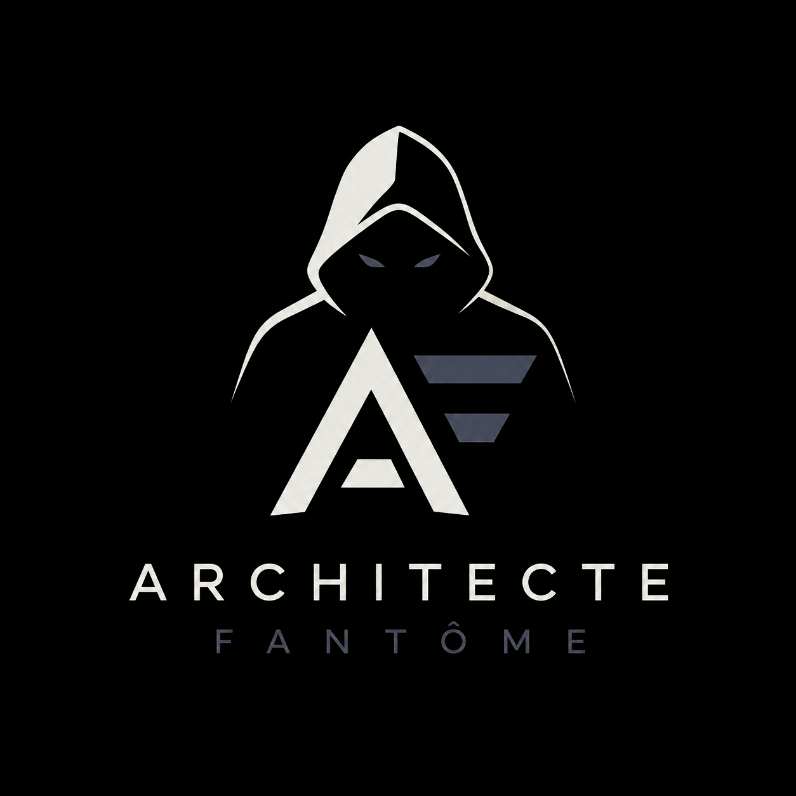

<div align="center">



<br>

> _Construire. Casser. Réparer. Concevoir. Exploiter. Arbitrer. Diriger._

</div>

# ARCHITECTE-FANTOME

ARCHITECTE-FANTOME (AF) est un parcours d’ingénierie logicielle orienté pratique. Il accompagne l’apprenant des fondamentaux vers la conception, la construction, la sécurisation, l’exploitation et l’évolution de systèmes logiciels complexes, y compris lorsqu’ils intègrent de l’IA.

Le parcours cherche à développer une capacité démontrable : expliquer pourquoi un système fonctionne, prévoir ses limites, diagnostiquer ses pannes, mesurer ses propriétés et défendre des décisions techniques. Terminer une page ou faire passer un exemple ne constitue pas, à lui seul, une preuve de maîtrise.

## Commencer ici

1. Lis **[Formation complète : ingénierie logicielle, systèmes, IA et leadership technique](FORMATION-COMPLETE-INGENIERIE.md)** pour comprendre les paliers et les objectifs.
2. Ouvre la **[route apprenant cohérente](06-ANNEXES-TRANSVERSES/58-ROUTE-APPRENANT-COHERENTE.md)** : elle indique l’ordre des ressources, les productions attendues et les étapes de remédiation.
3. Consulte le **[guide général](06-ANNEXES-TRANSVERSES/00-GUIDE.md)** et **[comment utiliser le parcours](06-ANNEXES-TRANSVERSES/01-COMMENT-UTILISER-LE-PARCOURS.md)** pour naviguer sans essayer de lire tous les fichiers.
4. Commence ensuite par **[START HERE](00-SOCLE/01-GETTING-STARTED/01-START_HERE.md)** et suis la progression `00 SOCLE → 01 CADRAGE → 02 CONSTRUCTION → 03 PILOTAGE → 04 ÉPREUVE → 05 MAÎTRISE`.

## Préparer ton environnement

Tu peux lire les leçons et faire les exercices conceptuels sans installer l’ensemble des outils. Avant une activité pratique, ouvre le `SETUP.md` le plus proche : il précise les prérequis de cette activité, les commandes de vérification et les solutions de secours lorsque c’est possible.

Les installations de Node.js, npm, Git, Docker ou d’autres outils se font **manuellement, par l’apprenant, seulement lorsqu’une activité en a besoin**. Suis la version demandée par le guide local et la documentation officielle correspondant à ton système. N’installe pas une technologie simplement parce qu’elle apparaît dans une annexe. Certains projets exécutables comprennent leur propre `package.json`, leurs tests ou leurs fichiers Docker : ce sont des supports de pratique à utiliser lorsque la route t’y conduit.

Le parcours privilégie les activités locales lorsque c’est possible. Une activité qui nécessite un réseau, un service externe ou un fournisseur IA doit le signaler dans ses prérequis ; les exemples d’IA restent des supports d’apprentissage et ne certifient pas un service prêt pour la production.

## La méthode de travail

Pour une compétence importante, suis cette boucle :

```text
Prédire le résultat
        ↓
Expliquer le mécanisme
        ↓
Pratiquer sans recopier
        ↓
Tester un cas limite
        ↓
Diagnostiquer et corriger
        ↓
Transférer à un autre contexte
        ↓
Revenir vérifier après un délai
```

Consigne les résultats dans la **[fiche d’apprentissage et de preuve](06-ANNEXES-TRANSVERSES/62-FICHE-APPRENTISSAGE-PREUVE.md)**. Utilise la page **[Progression](PROGRESSION.md)** comme tableau de bord personnel. Les [compétences de référence](MATRICE-COMPETENCES.csv) relient les capacités attendues à des ressources et des preuves observables.

## La route

```text
00 SOCLE
    ↓
01 CADRAGE
    ↓
02 CONSTRUCTION
    ↓
03 PILOTAGE
    ↓
04 ÉPREUVE
    ↓
05 MAÎTRISE
```

Les numéros indiquent une direction, pas une obligation de lire chaque fichier. La route canonique utilise les leçons, les mini-projets, les challenges et les ateliers intégrateurs déjà présents. Le CORE de 16 semaines / 192 heures est un parcours facultatif d’orientation ou d’accélération ; il ne représente pas toute la formation et ne garantit aucun niveau professionnel dans un délai donné.

Les laboratoires qui relient les domaines :

- [Fondations et raisonnement](06-ANNEXES-TRANSVERSES/64-LAB-FONDATIONS-ET-RAISONNEMENT.md)
- [Données, API et transactions](06-ANNEXES-TRANSVERSES/65-LAB-DONNEES-API-ET-TRANSACTIONS.md)
- [Data Engineering : pipelines, qualité, Kafka, Spark et orchestration](06-ANNEXES-TRANSVERSES/70-DATA-ENGINEERING-CORE/README.md)
- [Mathématiques & Machine Learning](06-ANNEXES-TRANSVERSES/71-MACHINE-LEARNING-MATH-CORE/README.md)
- [Sécurité et architecture](06-ANNEXES-TRANSVERSES/66-LAB-SECURITE-ET-ARCHITECTURE.md)
- [Tests d’ingénierie](06-ANNEXES-TRANSVERSES/63-LAB-TESTING-ENGINEERING.md)
- [DevOps et SRE](06-ANNEXES-TRANSVERSES/59-LAB-DEVOPS-LIFECYCLE.md)
- [Service IA/RAG de bout en bout](06-ANNEXES-TRANSVERSES/60-LAB-SERVICE-IA-END-TO-END.md)
- [Gate de release des systèmes IA](06-ANNEXES-TRANSVERSES/74-AI-ENGINEERING-RELEASE-GATE.md)
- [Capstone systèmes intégrés](06-ANNEXES-TRANSVERSES/72-DISTINGUISHED-SYSTEMS-CAPSTONE.md)
- [Practicum leadership technique](06-ANNEXES-TRANSVERSES/73-TECHNICAL-LEADERSHIP-PRACTICUM.md)

## Complétude et limites de validation

Les leçons identifiées comme incomplètes lors de la revue du 30 octobre ont reçu des exemples, pratiques, vérifications ou transferts ciblés. Les nouveaux modules Data Engineering et ML rendent obligatoires les compétences qui n’étaient auparavant qu’introduites ou proposées en approfondissement.

La complétude documentaire ne remplace pas une validation par un spécialiste indépendant ni une exécution sur une infrastructure réelle. Les activités indiquent leur environnement et leur niveau de preuve ; une simulation locale ne doit jamais être présentée comme une expérience de production.

## Cap professionnel

Le cap de long terme est de développer le jugement d’un ingénieur capable de concevoir et de faire évoluer des systèmes complexes, fiables, sûrs et soutenables. Les rôles Staff Engineer, Principal Engineer, Software Systems Architect ou Distinguished Engineer décrivent des périmètres qui varient selon les organisations ; ils ne sont ni des titres délivrés par ce curriculum, ni des résultats automatiques de sa complétion.

Le [noyau dur technique à l’horizon 2035+](06-ANNEXES-TRANSVERSES/40-NOYAU-DUR-STAFF-PRINCIPAL-2035.md) et le [portefeuille avancé de systèmes](05-MAITRISE/09-PORTFOLIO-SYSTEMES-2035/README.md) servent à approfondir ce cap lorsque les prérequis sont acquis.

## Une règle

Une bonne analogie aide à retenir une idée ; elle ne remplace jamais l’explication technique. Quand une mesure, un test, une source officielle ou une expérience contredit une hypothèse, réexamine cette hypothèse. La capacité à corriger son modèle mental fait partie de l’ingénierie.

Cette édition est une adaptation du curriculum ARCHITECTE-FANTOME destinée aux apprenants ; l’entrée en matière et certaines consignes de pratique ont été reformulées. Le curriculum conserve la licence CC BY-SA 4.0 et les exemples de code la licence CC0 1.0 indiquées dans le fichier `LICENSE`.

---

**ARCHITECTE-FANTOME** : _Des fondamentaux aux systèmes, puis au jugement d’ingénierie._

## Guides de lecture et de vérification

- [Glossaire général](GLOSSAIRE.md)
- [Méthode d’apprentissage autonome](06-ANNEXES-TRANSVERSES/68-METHODE-APPRENTISSAGE-AUTONOME.md)
- [Standard de complétude d’un module](06-ANNEXES-TRANSVERSES/69-STANDARD-COMPLETUDE-MODULE.md)
- [Route apprenant cohérente](06-ANNEXES-TRANSVERSES/58-ROUTE-APPRENANT-COHERENTE.md)
- [Dossier de preuves Staff](PREUVES-STAFF-ENGINEER.md)
