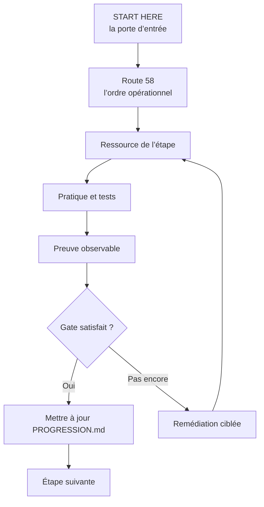
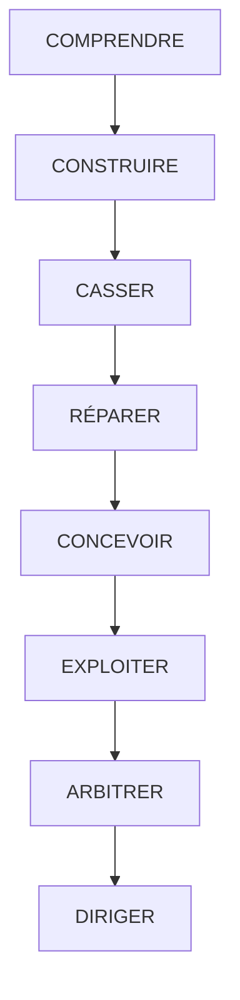
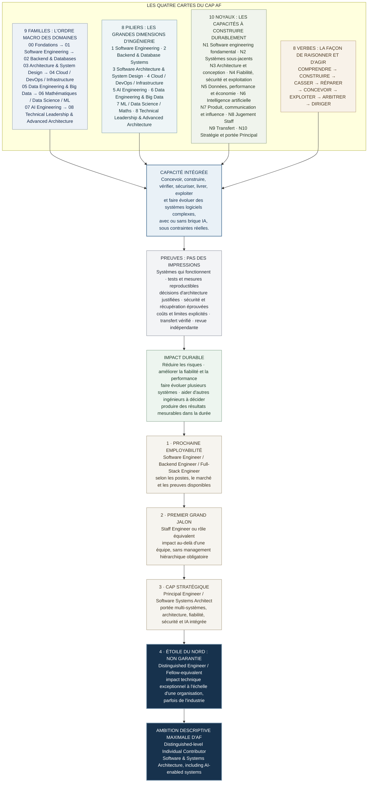

<div align="center">


<br>

> _Construire. Casser. Réparer. Concevoir. Exploiter. Arbitrer. Diriger._

</div>

# ARCHITECTE-FANTOME

ARCHITECTE-FANTOME (AF) est un parcours d’ingénierie logicielle orienté pratique. Il accompagne l’apprenant des fondamentaux vers la conception, la construction, la sécurisation, l’exploitation et l’évolution de systèmes logiciels complexes : plusieurs composants qui communiquent pour répondre à un besoin réel (par exemple, une plateforme de gestion du trafic réunissant interface, backend, base de données, cloud et éventuellement IA).

Le parcours cherche à développer une capacité démontrable : expliquer pourquoi un système fonctionne, prévoir ses limites, diagnostiquer ses pannes, mesurer ses propriétés et défendre des décisions techniques. Terminer une page ou faire passer un exemple ne constitue pas, à lui seul, une preuve de maîtrise.

**L'esprit AF : exigeant sur le fond, cool dans la manière.** Tu n'as pas besoin de parler comme un manuel de fusée pour devenir ingénieur. Les vrais termes restent présents, mais ils sont expliqués au bon endroit ; les analogies rendent une idée mémorable, mais elles ne remplacent jamais le mécanisme ni la pratique. Et non, ouvrir 200 fichiers en une soirée ne donne pas un niveau supérieur : ce qui compte, c'est ce que tu sais refaire et expliquer.

## Commencer ici : une seule porte d’entrée

**Ouvre d’abord [START HERE](00-SOCLE/01-GETTING-STARTED/01-START_HERE.md).** Suis son ordre sans prélecture obligatoire : Getting Started (préparer ton terrain), Prologue (comprendre les règles du jeu), puis la route apprenant. Pas de chasse au trésor dans tout le dépôt avant ta première mission.

- [58 : Route apprenant cohérente](06-ANNEXES-TRANSVERSES/58-ROUTE-APPRENANT-COHERENTE.md) est la référence opérationnelle pour savoir quoi faire, dans quel ordre et avec quelle preuve.
- [Formation complète](FORMATION-COMPLETE-INGENIERIE.md) décrit la cible, les huit phases et les paliers de capacité ; elle est une carte de référence, pas un prérequis avant le premier exercice.
- [83 : Ordre des neuf familles de domaines](06-ANNEXES-TRANSVERSES/83-ORDRE-DOMAINES-APPRENTISSAGE.md) donne la vue macro, de Fondations à Technical Leadership & Advanced Architecture.
- [Matrice des progressions](06-ANNEXES-TRANSVERSES/80-MATRICE-PROGRESSIONS.md) explique comment les différentes cartes d’AF s’articulent.
- Le [guide général](06-ANNEXES-TRANSVERSES/00-GUIDE.md) et [Comment utiliser le parcours](06-ANNEXES-TRANSVERSES/01-COMMENT-UTILISER-LE-PARCOURS.md) sont des références consultables au besoin, pas des lectures bloquantes.

### Trois niveaux de lecture : ne lis pas le dépôt en entier

1. **Maintenant :** la ressource de l'étape courante dans la Route 58, puis son exemple et sa pratique.
2. **Quand la route le demande :** les prérequis, mini-projets, laboratoires et modules spécialisés liés à cette étape.
3. **En référence :** annexes, matrices, grimoires et approfondissements ; ouvre-les pour répondre à une question précise ou préparer une étape ultérieure.

Les milliers de fichiers du dépôt représentent un corpus complet, pas un volume de lecture obligatoire pour commencer. Il n'y a pas de rattrapage de toutes les annexes : les statuts `différé` et `facultatif` sont réellement facultatifs jusqu'au moment de reprise indiqué. Tu n'as pas à débloquer toute la carte avant de jouer le premier niveau : la Route 58 te donne la mission suivante.

## Décoder la carte d’AF : plusieurs repères, un seul parcours

AF utilise plusieurs cartes complémentaires. Elles ne donnent pas toutes le même type d’information : certaines organisent les dossiers, d’autres décrivent les domaines, les capacités ou les preuves. **Tu n’as pas à les apprendre par cœur et elles ne sont pas des étapes supplémentaires.** Pense à un arc d'entraînement Naruto/DBZ : la Route 58 te donne la prochaine mission ; les autres cartes t'expliquent quel territoire tu explores et quelle capacité tu renforces. Elles ne te demandent pas de tout faire en parallèle.



La **Route 58** est le GPS opérationnel : elle indique le prochain travail, ses prérequis, la production attendue et le contrôle de sortie. Les autres cartes donnent des vues complémentaires du même curriculum. En particulier, les **9 familles** de la carte 83 organisent les grands domaines d’apprentissage ; les **8 piliers** de la matrice 81 servent à tracer les dimensions de compétences et de preuves. Les **10 noyaux** du document 40 décrivent des capacités durables à construire sur le long terme. Ces listes se complètent : elles ne se remplacent pas.

| Repère | Ce qu’il décrit | Référence |
| --- | --- | --- |
| **6 blocs (`00` à `05`)** | L’organisation physique des dossiers du dépôt. | Navigation des six blocs, plus bas |
| **Étapes `0` à `12`** | La progression opérationnelle, ses productions, ses gates et ses remédiations. `58` est l’identifiant du document, pas 58 étapes ni 58 semaines. | [Route 58](06-ANNEXES-TRANSVERSES/58-ROUTE-APPRENANT-COHERENTE.md) |
| **8 phases** | Les grandes phases de la formation complète. | [Formation complète](FORMATION-COMPLETE-INGENIERIE.md) |
| **9 familles (`00` à `08`)** | L’ordre macro dans lequel les domaines de compétences se construisent. | [Carte 83](06-ANNEXES-TRANSVERSES/83-ORDRE-DOMAINES-APPRENTISSAGE.md) |
| **8 piliers** | Les grandes dimensions utilisées pour relier compétences, preuves et gates au niveau Staff. | [Matrice 81](06-ANNEXES-TRANSVERSES/81-MATRICE-TRACEABILITE-STAFF.md) |
| **10 noyaux (`N1` à `N10`)** | Les capacités durables considérées comme non négociables pour le cap Staff → Principal → Distinguished-equivalent. | [Noyau dur 40](06-ANNEXES-TRANSVERSES/40-NOYAU-DUR-STAFF-PRINCIPAL-2035.md) |
| **8 verbes** | La progression mentale : les questions que tu apprends à te poser face à un système. | [La carte du Prologue](00-SOCLE/02-PROLOGUE/03-the-map.md) |
| **7 règles** | Le contrat de travail et d’apprentissage du parcours. | [Les règles du jeu](00-SOCLE/02-PROLOGUE/04-rules-of-the-game.md) |
| **Paliers `A` à `H`** | Des seuils de capacité et de preuve, pas des années d’étude ni des semaines. | [Formation complète](FORMATION-COMPLETE-INGENIERIE.md) |
| **Preuves `S1` à `S6`, plus `S7`** | Six familles de preuves Staff et une pièce supplémentaire consacrée au transfert. | [Dossier de preuves Staff](PREUVES-STAFF-ENGINEER.md) |
| **Gates `G1` à `G9`** | Neuf contrôles transversaux de préparation Staff ; ce ne sont pas neuf cours. | [Staff Readiness Gate 37](06-ANNEXES-TRANSVERSES/37-STAFF-READINESS-GATE.md) |

<details>
<summary><strong>Ouvrir la carte détaillée : phases, familles, piliers, noyaux et paliers</strong></summary>

### Les 8 phases de la formation complète

| Phase | Cap général |
| --- | --- |
| **1** | Fondations de programmation et pensée informatique (apprendre à raisonner et à donner des instructions précises à la machine). |
| **2** | Construction d’un logiciel maintenable (un logiciel qu'on peut corriger et faire évoluer sans tout casser). |
| **3** | Systèmes internes (processus, mémoire, fichiers, exécution et ressources d'un ordinateur). |
| **4** | Réseau, systèmes distribués (plusieurs composants qui communiquent) et architecture. |
| **5** | Sécurité, livraison et exploitation (mettre en service, surveiller, protéger et réparer). |
| **6** | Data Engineering (construire des flux de données), Mathématiques, Machine Learning (apprentissage automatique) et IA. |
| **7** | Plateformes, produit et leadership technique (faire adopter des décisions et aider les équipes à avancer). |
| **8** | Portée Principal et Distinguished (influence technique durable à grande échelle). |

Ces phases donnent la vue d’ensemble de la formation. Elles ne remplacent pas les étapes opérationnelles de la Route 58. Dans la phase 6, l’ordre spécialisé est **Data Engineering → Mathématiques / ML → AI Engineering**.

### Les 9 familles de domaines

| Repère | Famille | Ce qui se construit |
| --- | --- | --- |
| `00` | Fondations | Pensée informatique, programmation, logique, environnement et bases mathématiques. |
| `01` | Software Engineering (ingénierie logicielle) | Code maintenable, modularité (découpage en parties cohérentes), tests, contrats et évolution sûre. |
| `02` | Backend & Databases (partie serveur et bases de données) | API (interfaces qui permettent aux logiciels de communiquer), données, SQL (langage d'interrogation des bases relationnelles), transactions (opérations traitées comme un tout cohérent), persistance (conservation durable des données) et cohérence (absence de contradictions dans les données). |
| `03` | Architecture & System Design (conception globale d'un système) | Frontières, contrats, arbitrages, résilience (capacité à encaisser une panne) et systèmes distribués. |
| `04` | Cloud / DevOps / Infrastructure (services informatiques distants, pratiques qui rapprochent développement et exploitation, et ressources techniques) | Linux (système d'exploitation), livraison, cloud, automatisation, observabilité (mesurer ce que fait le système) et SRE (ingénierie de la fiabilité des services). |
| `05` | Data Engineering & Big Data (ingénierie des flux et grands volumes de données) | Pipelines (chaînes de traitement), qualité, stockage, orchestration (coordination automatique des tâches) et données à l’échelle. |
| `06` | Mathématiques / Data Science / ML (apprentissage automatique) | Statistiques, probabilités, algèbre linéaire, modélisation et évaluation. |
| `07` | AI Engineering (ingénierie des systèmes qui intègrent l'IA) | Intégration, évaluation, sécurité et exploitation des systèmes IA. |
| `08` | Technical Leadership & Advanced Architecture (leadership technique et architecture avancée) | Décisions transverses, plateformes, adoption et influence durable. |

Cette carte décrit un ordre macro, pas une règle « tout maîtriser à 100 % avant de continuer ». Les prérequis et gates de l’activité dans la Route 58 restent prioritaires. Sécurité, qualité, tests, observabilité et exploitation se construisent de manière transversale.

### Les 8 piliers

Les piliers sont les axes de traçabilité de la matrice 81. Ils montrent quelles dimensions une preuve peut couvrir ; ils ne constituent pas huit cours à ouvrir dès le début.

| Pilier | Dimension |
| --- | --- |
| **1. Software Engineering (ingénierie logicielle)** | Qualité du code, modularité (découpage cohérent), tests et évolution maîtrisée. |
| **2. Backend & Database Systems (serveurs et bases de données)** | Services, API (interfaces de communication), données et persistance. |
| **3. Software Architecture & System Design (conception des systèmes)** | Frontières, interactions, choix d’architecture et compromis. |
| **4. Cloud / DevOps / Infrastructure (infrastructure et exploitation)** | Livraison, automatisation, infrastructure et exploitation. |
| **5. AI Engineering (ingénierie IA)** | Intégration, évaluation, sécurité et gouvernance des systèmes IA. |
| **6. Data Engineering & Big Data (flux et grands volumes de données)** | Pipelines (chaînes de traitement), qualité, traçabilité et traitement des données. |
| **7. ML / Data Science / Maths (modèles et sciences des données)** | Fondations quantitatives, modèles et évaluation. |
| **8. Technical Leadership & Advanced Architecture (leadership technique et architecture avancée)** | Arbitrage, influence, mentorat et décisions à portée transverse. |

### Les 10 noyaux non négociables

Le document 40 décrit des capacités à construire sur la durée. Ce n’est **pas** une checklist de débutant ni dix technologies à apprendre en parallèle.

| Noyau | Capacité durable visée |
| --- | --- |
| **N1 : Software engineering fondamental** | Programmer, modéliser, tester, déboguer (chercher la cause d'un défaut), mesurer et faire évoluer du code. |
| **N2 : Systèmes et informatique sous-jacente** | Comprendre processus, mémoire, entrées-sorties (`I/O` : échanges entre le programme et l'extérieur), réseau, stockage, concurrence (plusieurs opérations qui se chevauchent) et pannes. |
| **N3 : Architecture et conception** | Partir des contraintes, définir les frontières, comparer les options et défendre les compromis (ce qu'on gagne et ce qu'on accepte de perdre). |
| **N4 : Fiabilité, sécurité et exploitation** | Prévenir, détecter, limiter et récupérer les défaillances tout en protégeant le système. |
| **N5 : Données, performance et économie** | Relier modèles de données, charge (quantité de travail reçue), performance, coûts et décisions produit. |
| **N6 : Intelligence artificielle : littératie mathématique et systèmes** | Comprendre les maths, le ML (apprentissage automatique) et les LLM (grands modèles de langage) assez bien pour architecturer, évaluer, sécuriser ou refuser une solution IA. |
| **N7 : Produit, communication et influence** | Clarifier les besoins et rendre les décisions compréhensibles, négociables et utiles. |
| **N8 : Jugement Staff** | Décider avec des informations incomplètes, mesurer, réviser et assumer les conséquences. |
| **N9 : Transfert** | Réutiliser un mécanisme dans un autre contexte en identifiant les invariants (ce qui doit rester vrai) et ce qui doit changer. |
| **N10 : Principal : stratégie et portée temporelle** | Construire une vision durable, réduire les risques systémiques et rendre les autres capables de décider. |

### Les 8 verbes de la carte mentale

Ces verbes sont tes réflexes d'ingénieur. Ils ne sont pas des badges à collectionner : dans une vraie mission, tu peux passer de l'un à l'autre plusieurs fois, comme une équipe qui adapte sa stratégie quand le boss change de tactique.



Ces verbes décrivent une manière de penser et d’agir, pas huit matières à terminer une par une. Selon la situation, tu peux revenir à une étape précédente : un incident peut obliger à comprendre de nouveau, réparer peut révéler un défaut de conception, et exploiter peut fournir les mesures qui changent un arbitrage.

### Les 7 règles du jeu

1. **Tu progresses par preuve :** lire donne une idée ; produire et expliquer démontrent une capacité.
2. **Le Boss compte plus que le compteur de pages :** le Boss (épreuve de synthèse) vérifie que tu sais agir quand plusieurs notions se croisent ; ce n'est pas un quiz de définitions.
3. **Le fil rouge revient partout :** un même problème évolue avec tes compétences, au lieu de te faire recommencer une application jetable à chaque chapitre.
4. **Les rétrospectives ferment les niveaux :** tu consignes acquis, fragilités, erreurs utiles et preuves.
5. **Le Mode Survie est une vue accélérée :** c'est un raccourci d'orientation, pas un raccourci magique ; il ne remplace pas le parcours canonique et ne transforme pas une lecture en maîtrise.
6. **Tu peux revenir en arrière :** une lacune repérée appelle une remédiation ciblée (un travail précis pour corriger cette lacune), pas une progression en faisant semblant.
7. **Les décisions ont des conséquences :** explique le problème, les contraintes, les options, la décision et ses effets.

### Les paliers de capacité A à H

| Palier | Capacité attendue |
| --- | --- |
| **A** | Fondations : expliquer et déboguer un petit programme, traiter les cas limites. |
| **B** | Ingénierie autonome : concevoir et livrer une petite application maintenable. |
| **C** | Système logiciel robuste : diagnostiquer des défaillances et justifier des mesures. |
| **D** | Livraison et exploitation : déployer, observer, restaurer et traiter des incidents. |
| **E** | Architecture et systèmes distribués : choisir et éprouver des architectures sous contraintes. |
| **F** | IA et systèmes de données : évaluer données, modèles, sécurité, coût et limites. |
| **G** | Leadership transverse (Staff / Principal) : aligner des équipes et réduire les risques systémiques. |
| **H** | Portée Distinguished-level : démontrer un impact durable et transverse dans des contextes réels. |

Un palier n’est ni un diplôme automatique, ni une durée. L’entrée et la sortie dépendent des prérequis et de preuves reproductibles. Les paliers G et H supposent progressivement du travail en équipe et sur des systèmes vivants.

### Les preuves S et les gates G : des repères avancés

Les familles de preuves Staff sont : **S1** Systèmes, backend et cloud ; **S2** Architecture logicielle ; **S3** Sécurité et fiabilité ; **S4** Produit et business ; **S5** Leadership et pédagogie ; **S6** Livraison et exploitation. **S7** est une pièce supplémentaire de pensée transférable : elle vérifie qu’un mécanisme peut être adapté ailleurs. Ce n’est pas une septième famille S équivalente aux six premières.

Les neuf gates transversaux vérifient : **G1** problème ambigu ; **G2** décision d’architecture ; **G3** fiabilité ; **G4** sécurité ; **G5** économie ; **G6** incident ; **G7** influence ; **G8** IA / automatisation ; **G9** transfert. Un gate est un contrôle, pas un chapitre ni un document qui se valide par sa seule présence.

Ces repères Staff sont à consulter lorsque la Route 58 et les prérequis t’y conduisent. Ils ne sont pas des prérequis à la première leçon de JavaScript.

</details>

## Lire les fichiers Markdown

Ouvre les fichiers `.md` en **aperçu Markdown** plutôt qu'en vue du texte source. Certaines ressources commencent par un bloc de métadonnées YAML (un petit en-tête structuré qui décrit le fichier) encadré par `---` ; d'autres contiennent des commentaires HTML (`<!-- ... -->`, des commentaires cachés dans l'aperçu). Ces éléments décrivent la ressource ou balisent la structure du dossier : ils ne font pas partie de la leçon à lire. Pour masquer aussi le bloc YAML initial, l'aperçu doit prendre en charge le _YAML Front Matter_ (la zone de métadonnées au début du fichier) ; les commentaires HTML sont destinés à rester cachés dans le rendu. Si ton lecteur affiche le YAML, utilise un aperçu compatible ou ignore uniquement ce bloc placé au début du fichier. **Ne supprime ni ne modifie ces métadonnées et commentaires** : ils peuvent porter des informations de stabilité, de progression, de provenance ou délimiter des sections utilisées par les index.

## Comprendre les numéros dans les noms de fichiers

Les préfixes numériques des fichiers et des dossiers facilitent le classement et les renvois ; **ils ne constituent pas, à eux seuls, une route de lecture globale**. Un dossier peut contenir des leçons `02` ou `03`, des pratiques `50` à `56`, un grimoire `90` et un challenge `95`. Ce classement peut aussi comporter des ressources complémentaires avec une lettre (`00A`, `01A`, `99A`, `06A`, `06B`) ou un dossier de sous-parcours (`06C`). La lettre distingue un identifiant associé ; elle ne signifie pas automatiquement « prochaine étape » et ne transforme pas les deux fichiers en doublons.

Pour connaître l'ordre réel, ouvre le `README.md` local puis suis la Route 58 lorsqu'elle désigne ce dossier. Dans un module, son tableau de route et ses prérequis explicites priment sur l'ordre alphabétique des noms. Si un dossier ne donne pas d'ordre clair, ne devine pas à partir des chiffres : signale l'ambiguïté et fais-la corriger.

Lorsqu'un dossier et un fichier voisin partagent le même numéro (`04-.../` et `04A-...md`, par exemple), ce ne sont pas automatiquement deux étapes. Le dossier contient une collection ou un sous-parcours ; le fichier avec lettre est une ressource compagne dont le rôle doit être expliqué dans le README parent. Si cette relation n'est pas indiquée, suis uniquement la route locale explicite et considère le nom comme ambigu.

## Le produit fil rouge et le style des leçons

Le parcours utilise **[Kintana](06-ANNEXES-TRANSVERSES/77-FIL-ROUGE-KINTANA/README.md)** comme cas d’étude pédagogique fictif commun : une plateforme de gestion de demandes et de rendez-vous pour plusieurs centres de services locaux. Kintana sert de terrain partagé pour illustrer les mécanismes ; ce n'est ni une entreprise réelle ni une preuve de production. Il ne remplace pas ton fil rouge personnel, choisi et qualifié après le Cadrage, que tu feras évoluer au fil de la formation. Chaque notion contribue à comprendre un système cohérent, plutôt qu'à une collection d'applications jetables.

Les clins d'œil à Naruto, DBZ, SNK, Garo, RnB, FIFA/PES, au football, à *Ça* de Stephen King, à *Breaking Bad*, à *Prison Break* ou à la musique peuvent donner une image qui marque. On les utilise quand ils éclairent vraiment une idée, pas pour coller une référence partout. **L'analogie fait tilt ; le mécanisme technique explique ; la pratique prouve.** Les principes de pratique, de preuve et de transfert sont présentés dans le [protocole de leçon approfondie](06-ANNEXES-TRANSVERSES/26-PROTOCOLE-LECON-PROFONDE.md).

**La règle de style :** une bonne leçon doit être simple à suivre, mais jamais simpliste. Elle garde les termes exacts, les explique juste à côté, aère la lecture et utilise un schéma quand il aide vraiment. Les références pop culture sont des petites lampes torches, pas le moteur du cours. Pas de mur de texte, pas de répétition décorative, pas de jargon abandonné au milieu de la route.

Un exemple AF doit rester crédible. Sur Kintana, si une connexion coupe au moment où une demande est envoyée, l'utilisateur peut réessayer et provoquer un doublon. L'exercice ne consiste pas à ajouter un bouton magique : il faut comprendre l'idempotence (garantir qu'une répétition de la même demande ne crée pas un second effet), la transaction en base de données, la reprise réseau, les tests et la trace laissée à l'opérateur.

## Préparer ton environnement

Tu peux lire les leçons et faire les exercices conceptuels sans installer l’ensemble des outils. Avant une activité pratique, commence par le [guide général de préparation](SETUP.md), puis ouvre le `SETUP.md` le plus proche de l’exercice : ce guide local précise les prérequis de l’activité, les commandes de vérification et les solutions de secours lorsque c’est possible ; il prévaut sur le guide général.

Les installations de Node.js (environnement qui permet d'exécuter JavaScript hors du navigateur), npm (outil qui installe et organise les paquets d'un projet), Git (outil de suivi des versions du code), Docker (outil qui emballe une application et son environnement dans des conteneurs) ou d’autres outils se font **manuellement, par l’apprenant, seulement lorsqu’une activité en a besoin**. Suis la version demandée par le guide local et la documentation officielle correspondant à ton système. N’installe pas une technologie simplement parce qu’elle apparaît dans une annexe. Certains projets exécutables comprennent leur propre `package.json` (fichier qui décrit le projet, ses dépendances et ses commandes), leurs tests ou leurs fichiers Docker : ce sont des supports de pratique à utiliser lorsque la route t’y conduit.

Le parcours privilégie les activités locales lorsque c’est possible (tu peux ainsi apprendre sans dépendre d'un compte cloud ou d'un service payant). Une activité qui nécessite un réseau, un service externe ou un fournisseur IA doit le signaler dans ses prérequis ; les exemples d’IA restent des supports d’apprentissage et ne certifient pas un service prêt pour la production.

Les informations qui évoluent : versions, prix, services cloud, sécurité, réglementation, marché et offres d'emploi : doivent être vérifiées auprès des sources officielles à la date d'utilisation. Une date de révision du document ne prouve pas que sa source externe a été reconsultée. En l'absence d'une date explicite de vérification de la source, considère les détails évolutifs comme **à confirmer**, et non comme une information garantie à jour.

## La méthode de travail

Pour une compétence importante, suis cette boucle. Le but n'est pas de réciter le cours comme une composition, mais de comprendre le mécanisme puis de voir s'il tient quand le contexte change :

```text
Prédire le résultat
        ↓
Expliquer le mécanisme
        ↓
Pratiquer sans recopier
        ↓
Tester un cas limite
        ↓
Diagnostiquer et corriger
        ↓
Transférer à un autre contexte
        ↓
Revenir vérifier après un délai
```

Pour chaque concept important, pose les questions qui évitent le blabla : **quoi ? pourquoi ? comment ça marche à l'intérieur ? quand l'utiliser ? quand ne pas l'utiliser ? jusqu'où ? quelles alternatives ? quels compromis, limites, pièges et prérequis ? quelles conséquences en production (sur un service réellement utilisé) ?**

Un exercice, un mini-projet ou une épreuve de synthèse (Boss Fight) doit te faire prendre une décision et affronter un problème crédible : doublon après une coupure réseau, réservation concurrente, droit d'accès mal appliqué, pipeline de données incomplet ou service externe indisponible. Pas de projet décoratif juste pour remplir une case.

Tu peux utiliser une IA comme copilote, mais pas lui céder le volant. Un morceau de code généré ne devient pas ta preuve tant que tu ne peux pas le lire, l'expliquer, le tester, le corriger, en vérifier la sécurité et défendre pourquoi tu le gardes.

Consigne les résultats dans la **[fiche d’apprentissage et de preuve](06-ANNEXES-TRANSVERSES/62-FICHE-APPRENTISSAGE-PREUVE.md)**. Utilise la page **[Progression](PROGRESSION.md)** comme tableau de bord personnel. Les [compétences de référence](MATRICE-COMPETENCES.csv) relient les capacités attendues à une ressource canonique (la ressource principale de référence) ; les ressources complémentaires sont listées dans [MATRICE-COMPETENCES-RESSOURCES.csv](MATRICE-COMPETENCES-RESSOURCES.csv) et expliquées dans [MATRICE-COMPETENCES-README.md](MATRICE-COMPETENCES-README.md).


## Lire les fichiers CSV sans se faire intimider

Les fichiers `.csv` sont des **tableaux de données**. CSV signifie *Comma-Separated Values* : des valeurs séparées par des virgules. Imagine un tableau Excel : une **colonne** décrit le type d’information, une **ligne** représente une entrée et une **cellule** contient une valeur. Dans AF, ces tableaux servent à organiser les compétences et leurs liens ; ce ne sont pas des cours à lire de haut en bas. Pas besoin de tout déchiffrer avant ton premier `console.log` : la Route 58 te guide, et tu consultes une matrice quand tu as une question précise.

Tu peux les ouvrir avec Excel ou LibreOffice Calc. Si toutes les données apparaissent dans une seule colonne, utilise l’import CSV et vérifie le séparateur `,` (virgule) ainsi que l’encodage UTF-8 (la règle qui permet d'afficher correctement les accents et autres caractères). Tu peux filtrer et rechercher les lignes ; **ne modifie pas les CSV pour noter ta progression personnelle**. Utilise [PROGRESSION.md](PROGRESSION.md) et tes fiches de preuve pour cela.

Garde cette distinction en tête : **la Route 58 donne l’ordre d’apprentissage ; les matrices CSV donnent des informations structurées sur les compétences, les ressources et les profils métiers.** Elles t’aident à te repérer, mais elles ne remplacent ni la route ni les consignes du README local.

<details>
<summary><strong>1. MATRICE-COMPETENCES.csv : Quelles compétences AF cherche-t-il à développer ?</strong></summary>

Cette matrice principale contient **56 compétences** dans cette version du dépôt. Le nombre sert à décrire le référentiel, pas à te donner 56 devoirs à ouvrir aujourd'hui. Chaque ligne décrit une capacité à développer et la manière de vérifier qu’elle est acquise.

| Colonne | Traduction simple |
| --- | --- |
| `competency_id` | Code unique de la compétence. Il permet de la retrouver dans les autres matrices. |
| `competence` | Nom de la capacité à développer. |
| `domain` | Famille à laquelle elle appartient : Fondations, Programmation, Backend (partie serveur), Sécurité, etc. |
| `mastery_palier` | Palier ou plage de paliers visés. `A-B`, par exemple, indique une compétence qui traverse plusieurs paliers ; ce n’est ni une note ni une durée. |
| `observable_outcome` | Résultat observable : ce que tu dois pouvoir faire, pas seulement réciter. |
| `assessment_and_evidence` | Évaluation et preuve pratique qui montrent ce que tu sais réellement faire. |
| `canonical_resource` | Chemin vers la ressource principale officielle pour travailler cette compétence. |
| `prerequisite_ids` | Codes des compétences à connaître avant celle-ci ; ce sont les prérequis (les bases nécessaires pour comprendre la suite). |

**Exemple : `FND-02` : Git et traçabilité.** La ligne indique le domaine `Fondations`, le palier `A`, un résultat attendu (créer une branche, isoler un changement, relire un `diff` et revenir à un état sûr), une preuve (exercice encadré et récupération), la ressource principale `00-SOCLE/01-GETTING-STARTED/05-git_101.md` et le prérequis `FND-01` (Shell, fichiers, environnement).

Un `diff` est simplement une comparaison qui montre ce qui a changé entre deux versions. Un identifiant comme `FND-02` est une étiquette stable : il permet de relier la même compétence dans plusieurs tableaux sans recopier son nom partout.

Une cellule `prerequisite_ids` vide signifie qu’aucun identifiant de prérequis n’est inscrit dans cette colonne ; cela ne t’autorise pas à ignorer l’ordre pédagogique de la Route 58 ou les prérequis du module.

</details>

<details>
<summary><strong>2. MATRICE-COMPETENCES-RESSOURCES.csv : Où trouver les ressources liées à une compétence ?</strong></summary>

Cette matrice contient **59 associations compétence–ressource**. Elle complète la matrice principale : une compétence peut avoir une ressource principale et plusieurs ressources complémentaires. C’est pourquoi elle peut avoir davantage de lignes que la matrice des compétences.

| Colonne | Traduction simple |
| --- | --- |
| `competency_id` | Code de la compétence concernée. |
| `resource_order` | Ordre de priorité des ressources pour cette compétence : `1` vient en premier. |
| `resource_role` | Rôle de la ressource : `primary` (principale) ou `supporting` (complémentaire). |
| `resource_path` | Chemin du fichier à ouvrir depuis la racine du dépôt. |

**Exemple : `NET-01`.** La compétence réseau possède une ressource `primary` (principale) sur les fondations DNS/TCP/TLS : DNS (associer un nom de domaine à une adresse), TCP (transport fiable des données) et TLS (chiffrement de la connexion) : puis des ressources `supporting` (complémentaires) sur HTTP (protocole du Web), REST (style de conception d'API), le debugging (diagnostic d'un défaut) et le distributed tracing (suivi d'une requête à travers plusieurs services). Le tableau conserve leur ordre et leur rôle au lieu de cacher plusieurs chemins dans une seule cellule.

Tu n’as pas à ouvrir toutes les ressources complémentaires dès que tu vois une compétence. Consulte d’abord la Route 58 et la ressource principale ; utilise les compléments lorsque la route, une leçon ou une difficulté les rend utiles.

</details>

<details>
<summary><strong>3. MATRICE-METIERS-COMPETENCES.csv : Comment les compétences se relient-elles aux métiers ?</strong></summary>

Cette matrice contient **336 associations entre six profils professionnels et les 56 compétences**. Elle ne crée pas de nouvelles compétences : elle indique comment les compétences déjà présentes dans la matrice principale se rapportent à différents profils.

| Code | Profil |
| --- | --- |
| `BE` | Software Engineer / Backend Engineer |
| `FS` | Full-Stack / Product Engineer |
| `AI` | AI Application Engineer (ingénieur qui construit des applications intégrant l'IA) |
| `QE` | Quality Engineer / SDET (ingénieur qualité / spécialiste des tests logiciels automatisés) |
| `SRE` | Platform / SRE Engineer (ingénieur plateforme / fiabilité des services) |
| `MOB` | Mobile Engineer |

Ses colonnes indiquent :

| Colonne | Traduction simple |
| --- | --- |
| `profile_id` / `profile_name` | Code et nom du profil professionnel. |
| `competency_id` / `competency_name` | Code et nom de la compétence associée. |
| `status` | Type d’attente de ce profil pour cette compétence (voir les quatre statuts ci-dessous). |
| `expected_depth` | Profondeur de maîtrise attendue pour ce profil. |
| `required_evidence` | Preuve attendue pour montrer cette maîtrise. |
| `existing_resource` | Ressource AF déjà disponible pour travailler la compétence. |
| `external_experience` | Indique si une expérience réelle ou une revue indépendante sera nécessaire. |

Les quatre statuts se lisent ainsi :

- `CORE_VALIDÉ` : compétence du socle commun à démontrer et valider.
- `DEPTH_REQUIS` : approfondissement nécessaire pour ce profil.
- `EXPERIENCE_EXTERNE` : preuve réelle ou revue indépendante à obtenir ; une simulation seule ne suffit pas.
- `HORS_PERIMETRE` : compétence non requise dans ce profil.

**Attention : ces statuts ne décrivent pas ton avancement personnel.** `CORE_VALIDÉ` ne signifie pas que la compétence est automatiquement acquise ou déjà validée chez toi ; il décrit l’attente associée au profil. Pour consulter un profil, filtre `profile_id`, puis regarde les compétences, leur profondeur et leurs preuves attendues. Tu ne dois pas recommencer le socle déjà validé ni apprendre toutes les compétences avec la même profondeur pour chaque métier.

</details>

### Quel fichier consulter pour quelle question ?

| Ta question | Le bon repère |
| --- | --- |
| « Dans quel ordre dois-je apprendre ? » | [Route 58](06-ANNEXES-TRANSVERSES/58-ROUTE-APPRENANT-COHERENTE.md) |
| « Quelles compétences le curriculum décrit-il ? » | [MATRICE-COMPETENCES.csv](MATRICE-COMPETENCES.csv) |
| « Quelles ressources sont associées à cette compétence ? » | [MATRICE-COMPETENCES-RESSOURCES.csv](MATRICE-COMPETENCES-RESSOURCES.csv) |
| « Quelles compétences sont liées à un profil professionnel ? » | [MATRICE-METIERS-COMPETENCES.csv](MATRICE-METIERS-COMPETENCES.csv) |
| « Qu’ai-je personnellement terminé et prouvé ? » | [PROGRESSION.md](PROGRESSION.md) et tes fiches de preuve |

Pour approfondir le fonctionnement des matrices, consulte le [mode d’emploi des matrices de compétences](MATRICE-COMPETENCES-README.md). Si un mot technique te bloque, cherche-le dans le [glossaire général](GLOSSAIRE.md) ; tu n’as pas besoin de mémoriser tout le vocabulaire avant de commencer.

## La route

```text
00 SOCLE (Construire tes fondations)
    ↓
01 CADRAGE (Comprendre avant de construire)
    ↓
02 CONSTRUCTION (Fabriquer la solution)
    ↓
03 PILOTAGE (Faire vivre et contrôler le système)
    ↓
04 ÉPREUVE (Prouver tes capacités)
    ↓
05 MAÎTRISE (Penser et agir comme un architecte)
```

Ce schéma montre les **six blocs physiques du dépôt** (`00` à `05`) : c'est l'organisation des dossiers, pas la liste complète des étapes pédagogiques. Les étapes de progression, l'ordre exact des ressources, les **gates** (points de contrôle à réussir avant de passer à la suite) et les **remédiations** (travail ciblé pour corriger une lacune avant de retenter) sont décrits dans la [Route 58](06-ANNEXES-TRANSVERSES/58-ROUTE-APPRENANT-COHERENTE.md), qui fait foi pour savoir quoi étudier ensuite. Une étape de cette route peut traverser plusieurs blocs physiques ; les deux cartes ne correspondent donc pas une à une.

Le bloc `00-SOCLE` comprend six modules principaux et une passerelle Python conditionnelle, à suivre uniquement avant une activité qui demande réellement Python et si les prérequis ne sont pas déjà maîtrisés. Elle n’est pas requise pour la route JavaScript de base. Les numéros des blocs indiquent une direction, pas une obligation de lire chaque fichier. La route canonique utilise les leçons, les mini-projets, les challenges et les ateliers intégrateurs déjà présents. Le CORE de 16 semaines / 192 heures est un parcours facultatif d’orientation ou d’accélération ; ce n'est pas un raccourci magique pour sauter les prérequis, il ne représente pas toute la formation et ne garantit aucun niveau professionnel dans un délai donné.

Les laboratoires qui relient les domaines :

- [Fondations et raisonnement](06-ANNEXES-TRANSVERSES/64-LAB-FONDATIONS-ET-RAISONNEMENT.md)
- [Données, API et transactions](06-ANNEXES-TRANSVERSES/65-LAB-DONNEES-API-ET-TRANSACTIONS.md)
- [Data Engineering : pipelines (chaînes de traitement), qualité, Kafka (plateforme de diffusion d'événements), Spark (moteur de traitement de données) et orchestration (coordination automatique des tâches)](06-ANNEXES-TRANSVERSES/70-DATA-ENGINEERING-CORE/README.md)
- [Mathématiques & Machine Learning (apprentissage automatique)](06-ANNEXES-TRANSVERSES/71-MACHINE-LEARNING-MATH-CORE/README.md)
- [Sécurité et architecture](06-ANNEXES-TRANSVERSES/66-LAB-SECURITE-ET-ARCHITECTURE.md)
- [Tests d’ingénierie](06-ANNEXES-TRANSVERSES/63-LAB-TESTING-ENGINEERING.md)
- [DevOps et SRE (ingénierie de la fiabilité des services)](06-ANNEXES-TRANSVERSES/59-LAB-DEVOPS-LIFECYCLE.md)
- [Platform Operations (exploitation d'une plateforme) : service, conteneur et drill de dégradation (exercice de panne contrôlée)](06-ANNEXES-TRANSVERSES/75-LAB-PLATFORM-OPERATIONS/README.md)
- [Service IA/RAG (génération augmentée par récupération de documents) de bout en bout](06-ANNEXES-TRANSVERSES/60-LAB-SERVICE-IA-END-TO-END.md)
- [Gate de release (contrôle avant mise en service) des systèmes IA](06-ANNEXES-TRANSVERSES/74-AI-ENGINEERING-RELEASE-GATE.md)
- [Capstone (projet de synthèse) systèmes intégrés](06-ANNEXES-TRANSVERSES/72-DISTINGUISHED-SYSTEMS-CAPSTONE.md)
- [Practicum (mise en pratique encadrée) leadership technique](06-ANNEXES-TRANSVERSES/73-TECHNICAL-LEADERSHIP-PRACTICUM.md)
- [Leadership Field Proof Pack (dossier de preuves de leadership) : RFC (proposition technique soumise à discussion), adoption, mentorat et impact](06-ANNEXES-TRANSVERSES/76-LEADERSHIP-FIELD-PROOF/README.md)

## Critères de progression et limites de validation

Une ressource n’est acquise que lorsque tu peux réaliser la pratique demandée, expliquer tes choix et produire les éléments de preuve indiqués. Lire une leçon ou terminer un exercice ne suffit pas, à lui seul, à démontrer une compétence transférable.

La complétude documentaire ne remplace pas une validation par un spécialiste indépendant ni une exécution sur une infrastructure réelle. Les activités indiquent leur environnement et leur niveau de preuve ; une simulation locale ne doit jamais être présentée comme une expérience de production.

## Cap professionnel

> **Spécialisations et frontières :** [82 : Cartographie DEPTH (approfondissement technique), MLOps (pratiques de mise en service et de suivi des modèles de machine learning) et applicabilité juridique](06-ANNEXES-TRANSVERSES/82-CARTOGRAPHIE-DEPTH-ET-APPLICABILITE.md).

Le cap de long terme est de développer le jugement d’un ingénieur capable de concevoir et de faire évoluer des systèmes complexes, fiables, sûrs et soutenables. Les rôles Staff Engineer, Principal Engineer, Software Systems Architect ou Distinguished Engineer décrivent des périmètres qui varient selon les organisations ; ils ne sont ni des titres délivrés par ce curriculum, ni des résultats automatiques de sa complétion.

Le [noyau dur technique à l’horizon 2035+](06-ANNEXES-TRANSVERSES/40-NOYAU-DUR-STAFF-PRINCIPAL-2035.md) et le [portefeuille avancé de systèmes](05-MAITRISE/09-PORTFOLIO-SYSTEMES-2035/README.md) servent à approfondir ce cap lorsque les prérequis sont acquis. Avant de lancer un de ses dix projets, suis le [parcours de préparation avec les leçons exactes et les gates d’entrée](05-MAITRISE/09-PORTFOLIO-SYSTEMES-2035/00-PARCOURS-PREPARATION.md).

## Une règle

Une bonne analogie aide à retenir une idée ; elle ne remplace jamais l’explication technique. Quand une mesure, un test, une source officielle ou une expérience contredit une hypothèse, réexamine cette hypothèse. La capacité à corriger son modèle mental fait partie de l’ingénierie.

Cette édition est une adaptation du curriculum ARCHITECTE-FANTOME destinée aux apprenants ; l’entrée en matière et certaines consignes de pratique ont été reformulées. Le curriculum conserve la licence CC BY-SA 4.0 et les exemples de code la licence CC0 1.0 indiquées dans le fichier `LICENSE`.

---

**ARCHITECTE-FANTOME** : _Des fondamentaux aux systèmes, puis au jugement d’ingénierie._

## Ressources de référence

- [Glossaire général](GLOSSAIRE.md)
- [Méthode d’apprentissage autonome](06-ANNEXES-TRANSVERSES/68-METHODE-APPRENTISSAGE-AUTONOME.md)
- [Standard de complétude d’un module](06-ANNEXES-TRANSVERSES/69-STANDARD-COMPLETUDE-MODULE.md)
- [Route apprenant cohérente](06-ANNEXES-TRANSVERSES/58-ROUTE-APPRENANT-COHERENTE.md)
- [Dossier de preuves Staff](PREUVES-STAFF-ENGINEER.md)

## Ressources pratiques associées

- [Préparer l'activité (`SETUP.md`)](SETUP.md) : environnement, prérequis et commandes.

## Navigation des six blocs

- [00 : Socle](00-SOCLE/README.md) : fondamentaux et démarrage.
- [01 : Cadrage](01-CADRAGE/README.md) : raisonnement, async (asynchrone : une opération peut attendre sans bloquer toute l'application) et debugging (diagnostic méthodique des défauts).
- [02 : Construction](02-CONSTRUCTION/README.md) : modules, tests et mini-projets.
- [03 : Pilotage](03-PILOTAGE/README.md) : sécurité, fiabilité et conduite.
- [04 : Épreuve : Field Exit Card (fiche de sortie terrain)](04-EPREUVE/00-FIELD-EXIT-CARD.md) : preuve de sortie et préparation de la validation.
- [Validation externe](04-EPREUVE/08-EXTERNAL-VALIDATION/README.md) : périmètre et modalités de revue par un tiers.
- [05 : Maîtrise](05-MAITRISE/README.md) : approfondissements et portefeuille avancé.
- [Annexes transverses](06-ANNEXES-TRANSVERSES/README.md) : index des ressources complémentaires.
## GOD OBJECTIF : Le cap absolu d’ARCHITECTE-FANTOME

> **Tu ne fais pas AF pour finir une pile de cours. Tu le fais pour devenir un ingénieur capable de prendre la responsabilité technique de systèmes complexes : les comprendre, les construire, les sécuriser, les faire fonctionner, les faire évoluer et défendre les décisions qui les engagent.**

Le cap d’AF est d’abord une **capacité d’ingénierie démontrable**, pas un intitulé à afficher sur un CV. Le titre professionnel peut changer selon les entreprises ; la mission, elle, doit rester valable. Pense à un objectif de carrière comme à une boussole, pas comme à un trophée déjà gagné dans le menu.

### La carte maîtresse : de l’apprentissage à l’impact

Le diagramme rassemble les quatre cartes qui définissent le cap d’AF. Elles se complètent, mais **ne sont pas quatre séries de cours à enchaîner** : les familles donnent l’ordre macro des domaines, les piliers montrent leur largeur, les noyaux décrivent les capacités durables et les verbes donnent la manière d’agir.



**Comment lire cette carte :** les flèches entre les quatre cartes et la capacité intégrée signifient qu'elles contribuent ensemble au même objectif. Elles ne disent pas qu'il faut finir un pilier entier avant d'en toucher un autre. L'ordre réel de ton travail reste celui de la [Route 58](06-ANNEXES-TRANSVERSES/58-ROUTE-APPRENANT-COHERENTE.md), avec les prérequis et les gates de chaque activité.

### 1. Les 10 noyaux non négociables : ce que tu dois réellement savoir faire

Le document [40 : Noyau dur technique](06-ANNEXES-TRANSVERSES/40-NOYAU-DUR-STAFF-PRINCIPAL-2035.md) décrit ces capacités comme le socle durable du cap Staff → Principal → Distinguished-equivalent. Ce ne sont pas dix cours ni dix technologies à apprendre simultanément.

| Noyau | Capacité durable attendue |
| --- | --- |
| **N1 : Software engineering fondamental** | Programmer, modéliser, tester, déboguer, structurer et faire évoluer du code sans dépendre d'une recette. |
| **N2 : Systèmes et informatique sous-jacente** | Comprendre processus, mémoire, I/O (entrées-sorties), réseau, stockage, concurrence (opérations qui se chevauchent), cache (copie temporaire rapide), files (mécanismes d'attente), réplication (copies maintenues entre systèmes) et pannes partielles (une partie tombe pendant que le reste continue). |
| **N3 : Architecture et conception** | Partir des contraintes, définir les frontières, comparer les options, expliciter les compromis et préparer l'évolution d'un système. |
| **N4 : Fiabilité, sécurité et exploitation** | Protéger, observer, détecter, limiter l'impact d'une panne, restaurer et apprendre d'un incident. |
| **N5 : Données, performance et économie** | Relier modèle de données, charge, performance, saturation, coût d'exploitation et décision produit. |
| **N6 : Intelligence artificielle : littératie mathématique et systèmes** | Comprendre les bases mathématiques, le ML (apprentissage automatique) et les LLM (grands modèles de langage) assez bien pour architecturer, évaluer, sécuriser ou refuser une solution IA. |
| **N7 : Produit, communication et influence** | Reformuler un besoin, parler risque/coût/impact, expliquer une décision, négocier et aider d'autres personnes à progresser. |
| **N8 : Jugement Staff** | Prendre et réviser une décision défendable quand le problème est ambigu et l'information incomplète. |
| **N9 : Transfert** | Reconnaître les invariants d'un mécanisme, l'adapter à un autre contexte et produire une nouvelle preuve. |
| **N10 : Principal : stratégie et portée temporelle** | Construire une vision à long terme, arbitrer un portefeuille de systèmes (l'ensemble des systèmes et services dont il faut gérer les priorités), établir des standards utiles et développer d'autres leaders techniques. |

**Le sens de « non négociable » :** aucune spécialisation ne dispense de ces capacités. Ce sont les muscles profonds de l'ingénieur : ils se renforcent sur plusieurs projets et ne s'acquièrent pas en cochant une case. Leur profondeur augmente cependant avec le contexte et le niveau visé ; tu ne dois pas tout maîtriser au niveau Principal avant d'apprendre à programmer.

### 2. Les 8 piliers : les grands territoires de compétence

La [matrice 81 : Traçabilité des huit piliers](06-ANNEXES-TRANSVERSES/81-MATRICE-TRACEABILITE-STAFF.md) relie ces domaines aux preuves S et aux gates G. Un pilier est une dimension à couvrir dans ton développement, pas une étape chronologique isolée.

| Pilier | Territoire | Ce que tu dois progressivement être capable de faire |
| --- | --- | --- |
| **1. Software Engineering** | Ingénierie logicielle | Produire du code fiable, testable, lisible et évolutif. |
| **2. Backend & Database Systems** | Services et données | Concevoir API (interfaces de communication), modèles de données, transactions (opérations traitées comme un tout cohérent) et persistance (conservation durable des données). |
| **3. Software Architecture & System Design** | Architecture | Définir les frontières, contrats, interactions et compromis d'un système. |
| **4. Cloud / DevOps / Infrastructure** | Infrastructure et exploitation | Livrer, automatiser, observer, sécuriser et restaurer des services. |
| **5. AI Engineering** | Systèmes intégrant l'IA | Intégrer et évaluer des systèmes IA, RAG (génération augmentée par récupération de documents) et LLM (grands modèles de langage) avec sécurité, contrôle d'accès, coûts, limites et mécanismes d'arrêt. |
| **6. Data Engineering & Big Data** | Plateformes de données | Construire des pipelines fiables, rejouables, traçables et contrôlés. |
| **7. ML / Data Science / Maths** | Modélisation quantitative | Raisonner sur données, statistiques, modèles, métriques, incertitude et généralisation. |
| **8. Technical Leadership & Advanced Architecture** | Portée technique transverse | Faire adopter des décisions, standards et architectures au-delà de son propre code. |

### 3. Les 9 familles : l'ordre macro des domaines à construire

La [carte 83 : Ordre des neuf familles](06-ANNEXES-TRANSVERSES/83-ORDRE-DOMAINES-APPRENTISSAGE.md) donne la progression de référence des grands domaines. Cette séquence sert à comprendre les dépendances ; elle ne signifie pas « maîtriser 100 % d'une famille avant de toucher à la suivante ».

| Ordre | Famille | Construction principale |
| --- | --- | --- |
| **00** | Fondations | Pensée informatique, programmation, logique, algorithmique, environnement, Git (suivi des versions du code) et mathématiques de base. |
| **01** | Software Engineering | Code maintenable, modularité, tests, refactoring (réorganiser le code sans changer son comportement attendu), contrats, qualité et évolution sûre. |
| **02** | Backend & Databases | API (interfaces de communication), runtime (environnement qui exécute le programme), réseau, modèles de données, SQL (langage des bases relationnelles), transactions, persistance et cohérence. |
| **03** | Architecture & System Design | Frontières, contrats, arbitrages, systèmes distribués (plusieurs services qui coopèrent), résilience et évolutivité. |
| **04** | Cloud / DevOps / Infrastructure | Linux (système d'exploitation), sécurité, livraison reproductible, cloud (ressources informatiques accessibles à distance), DevOps (pratiques qui rapprochent développement et exploitation), CI/CD (automatisation des vérifications et déploiements), IaC (infrastructure décrite et gérée par du code), observabilité (mesures et traces du système), SRE (ingénierie de la fiabilité des services) et restauration. |
| **05** | Data Engineering & Big Data | Ingestion batch (traitement par lots) ou streaming (traitement au fil de l'arrivée des données), pipelines, qualité, stockage, orchestration (coordination automatique des tâches), rejeu et traçabilité. |
| **06** | Mathématiques / Data Science / ML | Statistiques, probabilités, algèbre linéaire, optimisation, modélisation et évaluation sans fuite de données (aucune information du jeu de test ne doit contaminer l'apprentissage). |
| **07** | AI Engineering | RAG (génération augmentée par récupération de documents), LLM (grands modèles de langage), retrieval (recherche des informations utiles avant la réponse), évaluation, sécurité, contrôle d'accès, coûts, supervision et arrêt. |
| **08** | Technical Leadership & Advanced Architecture | Décisions transverses, plateformes, arbitrages, migration, mentorat, adoption et influence durable. |

**Dépendance à ne pas inverser :** dans la phase spécialisée IA, la carte 83 prévoit **Data Engineering → Mathématiques / ML → AI Engineering**. Les mathématiques élémentaires et la pensée quantitative commencent néanmoins dès les Fondations ; l'architecture, la sécurité, les tests et l'exploitation se renforcent de manière transversale.

### 4. Les 8 verbes : ta façon d'agir face à n'importe quel système

La [carte mentale du Prologue](00-SOCLE/02-PROLOGUE/03-the-map.md) décrit une progression de raisonnement. Ces verbes ne sont pas des matières scolaires : ce sont les gestes intellectuels que tu dois apprendre à mobiliser sur un problème réel.

| Verbe | Question à te poser | Comportement attendu |
| --- | --- | --- |
| **COMPRENDRE** | Qu'est-ce qui se passe réellement ? | Lire, observer, suivre l'exécution, nommer les inconnues et vérifier les bases. |
| **CONSTRUIRE** | Quelle est la plus petite solution utile ? | Transformer un besoin en comportement concret, puis en code testable. |
| **CASSER** | Dans quelles conditions ma solution échoue-t-elle ? | Chercher les cas limites, les hypothèses fragiles et les modes de panne. |
| **RÉPARER** | Quelle cause explique le défaut ? | Formuler une hypothèse, diagnostiquer, corriger et vérifier sans masquer le problème. |
| **CONCEVOIR** | Quelle forme répond le mieux aux contraintes ? | Comparer plusieurs options, définir les frontières et justifier les compromis. |
| **EXPLOITER** | Comment le système se comporte-t-il en fonctionnement ? | Observer, sécuriser, mesurer, maintenir, restaurer et apprendre des incidents. |
| **ARBITRER** | Quel compromis est acceptable, et pourquoi ? | Mettre en balance coût, risque, délai, performance, fiabilité et besoin utilisateur. |
| **DIRIGER** | Comment rendre la décision utile au-delà de moi ? | Communiquer, aligner, transmettre, mentorer et favoriser l'adoption sans dépendance à une seule personne. |

### 5. La destination professionnelle : des jalons, pas un titre promis

La référence 40 distingue volontairement quatre horizons. Ils servent à garder une direction réaliste, sans confondre la prochaine employabilité avec l'ambition maximale.

| Horizon | Repère professionnel | Ce que cela veut dire concrètement |
| --- | --- | --- |
| **Prochaine employabilité** | Software Engineer / Backend Engineer / Full-Stack Engineer (développement côté interface et côté serveur), selon les postes accessibles | Savoir contribuer à un logiciel de bout en bout, expliquer ses choix et apporter des preuves vérifiables. Le premier intitulé dépend du marché, des opportunités et de ton expérience réelle. |
| **Premier grand jalon technique** | **Staff Engineer** ou rôle équivalent | Avoir un impact au-delà d'une équipe, prendre des décisions robustes, réduire les risques systémiques et influencer sans management hiérarchique obligatoire. |
| **Cap stratégique de long terme** | **Principal Engineer / Software Systems Architect** | Porter une vision multi-systèmes, notamment en architecture, systèmes distribués, fiabilité, sécurité et systèmes intégrant l'IA. |
| **Étoile du Nord : non garantie** | **Distinguished Engineer / Fellow-equivalent** (niveau d'expertise technique très élevé) dans une organisation qui possède ce niveau | Avoir un impact technique exceptionnel à l'échelle de l'entreprise, parfois de l'industrie, corroboré par des résultats durables et une confiance gagnée dans le temps. |

**Formulation descriptive de l'ambition maximale d'AF :**

> **Distinguished-level Individual Contributor : Software & Systems Architecture, including AI-enabled systems.**
>
> En français : un expert technique individuel de niveau Distinguished (expertise technique reconnue à très grande échelle), spécialisé dans l'architecture des systèmes logiciels, y compris les systèmes intégrant l'IA. _Individual Contributor_ désigne ici une trajectoire d'expertise technique sans obligation de devenir manager hiérarchique.

Ce n'est pas une promesse qu'un intitulé précis comme « Distinguished Architect AI Engineer » sera standard, existera dans toutes les entreprises ou sera accessible dans un délai donné. **AI Engineering est un pilier majeur d'AF, mais l'IA est une compétence intégrée à l'architecture des systèmes, pas une identité de carrière exclusive.** L'objectif est de savoir choisir quand l'IA apporte une valeur réelle, comment l'évaluer et la sécuriser : et aussi quand ne pas l'utiliser. Un bon architecte ne colle pas un modèle IA sur chaque problème pour faire joli : il doit pouvoir défendre le choix avec des mesures, des limites et un vrai besoin.

### 6. À quoi ressemblera une preuve de niveau élevé ?

Le niveau ne se démontre pas par le nombre de fichiers lus, les technologies installées ou le fait d'avoir terminé un projet guidé. À mesure que tu avances, les preuves doivent montrer que tu peux :

Un exemple de preuve intégrée : sur Kintana, une demande est envoyée, la connexion coupe, puis le client réessaie. Tu dois éviter le doublon, préserver la réservation, tracer ce qui s'est passé, protéger les rôles et mesurer le comportement. Une seule situation fait alors travailler plusieurs mécanismes d'ingénierie ; ce n'est pas un exercice décoratif.

- concevoir un système à partir d'un besoin ambigu, de contraintes et d'hypothèses explicites ;
- comparer des options et défendre une décision, y compris l'option rejetée et les conditions qui feraient changer d'avis ;
- construire et faire fonctionner le système, puis mesurer ses comportements, ses coûts et ses limites ;
- tester la sécurité, provoquer ou analyser une panne, limiter son impact, restaurer et expliquer ce qui s'est passé ;
- évaluer une brique IA (composant logiciel qui utilise un modèle) avec des cas normaux, ambigus et adversariaux (conçus pour révéler ses faiblesses), ou justifier de ne pas en utiliser ;
- examiner du code proposé par une IA, retrouver ses hypothèses, vérifier ses tests, sa sécurité et son comportement avant de l'accepter ;
- transférer un principe vers un contexte différent et vérifier ce qui doit être adapté ;
- faire adopter une décision ou un standard par d'autres personnes et montrer un effet réel, pas seulement rédiger une recommandation ;
- accepter une revue contradictoire et distinguer précisément ta contribution de celle des autres.

Une simulation locale (un scénario contrôlé sur ta machine) peut prouver un raisonnement dans son périmètre ; elle ne devient pas une expérience collaborative ou de production (un service réellement utilisé et exploité) par simple changement de vocabulaire. Les preuves doivent conserver leur contexte réel : `SIMULATION`, `PERSONNEL`, `COLLABORATIF`, `EXTERNE` ou `PRODUCTION`, selon ce qui a effectivement été réalisé.

### 7. Ton chronomètre : les preuves, pas une course au calendrier

AF ne fixe pas une durée universelle pour devenir Staff, Principal ou Distinguished. Le CORE de 16 semaines / 192 heures est une orientation facultative, pas un raccourci vers ces niveaux. La progression sérieuse se mesure par ce que tu peux refaire, expliquer, vérifier et transférer : pas par le nombre de jours écoulés. Ton chronomètre n'affiche donc pas « combien de fichiers restent à lire ? », mais « quelle capacité puis-je démontrer aujourd'hui que je ne savais pas démontrer hier ? ».

Pour chaque étape, ton vrai chronomètre est simple :

1. **Je peux expliquer** le mécanisme sans réciter le texte.
2. **Je peux refaire** la pratique sans recopier la solution.
3. **Je peux casser et réparer** au moins une hypothèse ou un cas limite pertinent.
4. **Je peux prouver** le résultat par un artefact, un test, une mesure ou une décision vérifiable.
5. **Je peux transférer** le principe à un autre contexte, lorsque le niveau le demande.
6. **Je peux dire honnêtement** ce qui est acquis, ce qui reste fragile et ce qui n'a pas encore été testé.

La [Route 58](06-ANNEXES-TRANSVERSES/58-ROUTE-APPRENANT-COHERENTE.md) choisit ton prochain pas ; les gates indiquent quand tu peux avancer ou quand une remédiation est nécessaire ; [PROGRESSION.md](PROGRESSION.md) garde la trace de ton avancement. **Ne cours pas après le titre final en sautant les fondations : construis les capacités qui rendraient ce titre crédible.**

**En une phrase :** AF vise à former un ingénieur capable de concevoir et de faire évoluer des systèmes logiciels complexes, fiables, sûrs et économiquement soutenables, d'y intégrer l'IA avec discernement, puis d'influencer durablement la manière dont plusieurs personnes ou équipes les construisent et les exploitent : jusqu'à une portée Principal, avec Distinguished/Fellow comme étoile du Nord non garantie. Le parcours doit rester vivant et exigeant : on peut sourire pendant l'entraînement, mais la preuve finale doit tenir face au réel.
