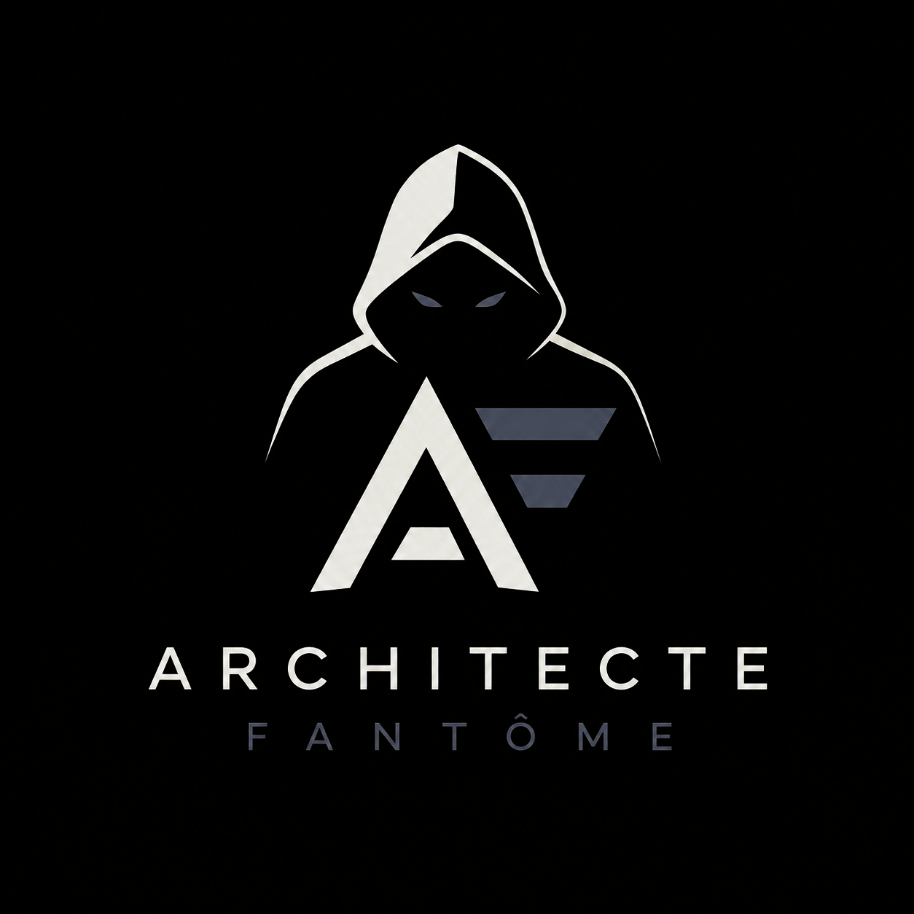
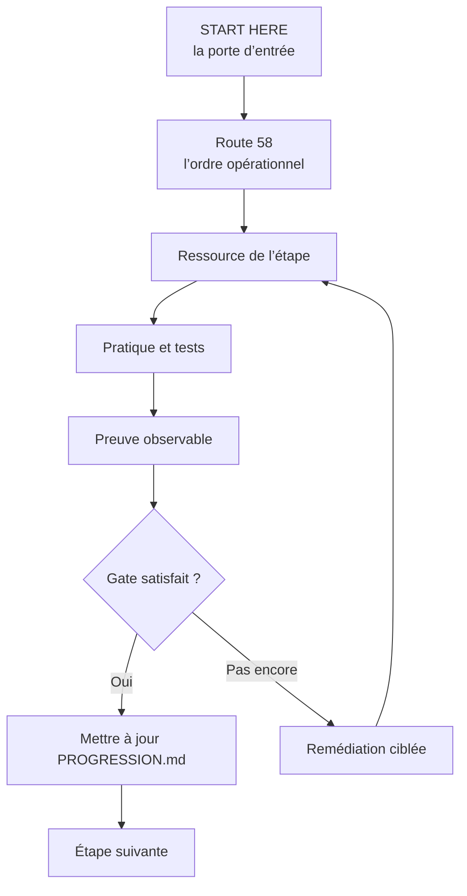
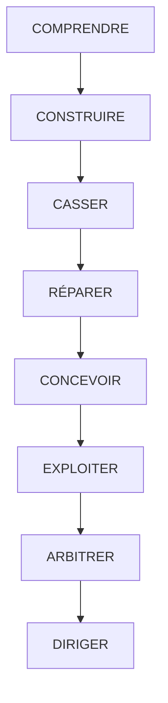

<div align="center">



<br>

> _Construire. Casser. Réparer. Concevoir. Exploiter. Arbitrer. Diriger._

</div>

# ARCHITECTE-FANTOME

ARCHITECTE-FANTOME (AF) est un parcours d’ingénierie logicielle orienté pratique. Il accompagne l’apprenant des fondamentaux vers la conception, la construction, la sécurisation, l’exploitation et l’évolution de systèmes logiciels complexes : plusieurs composants qui communiquent pour répondre à un besoin réel (par exemple, une plateforme de gestion du trafic réunissant interface, backend, base de données, cloud et éventuellement IA).

Le parcours cherche à développer une capacité démontrable : expliquer pourquoi un système fonctionne, prévoir ses limites, diagnostiquer ses pannes, mesurer ses propriétés et défendre des décisions techniques. Terminer une page ou faire passer un exemple ne constitue pas, à lui seul, une preuve de maîtrise.

## Commencer ici : une seule porte d’entrée

**Ouvre d’abord [START HERE](00-SOCLE/01-GETTING-STARTED/01-START_HERE.md).** Suis son ordre sans prélecture obligatoire : Getting Started, Prologue, puis la route apprenant.

- [58 : Route apprenant cohérente](06-ANNEXES-TRANSVERSES/58-ROUTE-APPRENANT-COHERENTE.md) est la référence opérationnelle pour savoir quoi faire, dans quel ordre et avec quelle preuve.
- [Formation complète](FORMATION-COMPLETE-INGENIERIE.md) décrit la cible, les huit phases et les paliers de capacité ; elle est une carte de référence, pas un prérequis avant le premier exercice.
- [83 : Ordre des neuf familles de domaines](06-ANNEXES-TRANSVERSES/83-ORDRE-DOMAINES-APPRENTISSAGE.md) donne la vue macro, de Fondations à Technical Leadership & Advanced Architecture.
- [Matrice des progressions](06-ANNEXES-TRANSVERSES/80-MATRICE-PROGRESSIONS.md) explique comment les différentes cartes d’AF s’articulent.
- Le [guide général](06-ANNEXES-TRANSVERSES/00-GUIDE.md) et [Comment utiliser le parcours](06-ANNEXES-TRANSVERSES/01-COMMENT-UTILISER-LE-PARCOURS.md) sont des références consultables au besoin, pas des lectures bloquantes.

### Trois niveaux de lecture : ne lis pas le dépôt en entier

1. **Maintenant :** la ressource de l'étape courante dans la Route 58, puis son exemple et sa pratique.
2. **Quand la route le demande :** les prérequis, mini-projets, laboratoires et modules spécialisés liés à cette étape.
3. **En référence :** annexes, matrices, grimoires et approfondissements ; ouvre-les pour répondre à une question précise ou préparer une étape ultérieure.

Les milliers de fichiers éventuels du dépôt représentent un corpus complet, pas un volume de lecture obligatoire pour commencer. Il n'y a pas de rattrapage de toutes les annexes : les statuts `différé` et `facultatif` sont réellement facultatifs jusqu'au moment de reprise indiqué.

## Décoder la carte d’AF : plusieurs repères, un seul parcours

AF utilise plusieurs cartes complémentaires. Elles ne donnent pas toutes le même type d’information : certaines organisent les dossiers, d’autres décrivent les domaines, les capacités ou les preuves. **Tu n’as pas à les apprendre par cœur et elles ne sont pas des étapes supplémentaires.**



La **Route 58** est le GPS opérationnel : elle indique le prochain travail, ses prérequis, la production attendue et le contrôle de sortie. Les autres cartes donnent des vues complémentaires du même curriculum. En particulier, les **9 familles** de la carte 83 organisent les grands domaines d’apprentissage ; les **8 piliers** de la matrice 81 servent à tracer les dimensions de compétences et de preuves. Les **10 noyaux** du document 40 décrivent des capacités durables à construire sur le long terme. Ces listes se complètent : elles ne se remplacent pas.

| Repère | Ce qu’il décrit | Référence |
| --- | --- | --- |
| **6 blocs (`00` à `05`)** | L’organisation physique des dossiers du dépôt. | Navigation des six blocs, plus bas |
| **Étapes `0` à `12`** | La progression opérationnelle, ses productions, ses gates et ses remédiations. `58` est l’identifiant du document, pas 58 étapes ni 58 semaines. | [Route 58](06-ANNEXES-TRANSVERSES/58-ROUTE-APPRENANT-COHERENTE.md) |
| **8 phases** | Les grandes phases de la formation complète. | [Formation complète](FORMATION-COMPLETE-INGENIERIE.md) |
| **9 familles (`00` à `08`)** | L’ordre macro dans lequel les domaines de compétences se construisent. | [Carte 83](06-ANNEXES-TRANSVERSES/83-ORDRE-DOMAINES-APPRENTISSAGE.md) |
| **8 piliers** | Les grandes dimensions utilisées pour relier compétences, preuves et gates au niveau Staff. | [Matrice 81](06-ANNEXES-TRANSVERSES/81-MATRICE-TRACEABILITE-STAFF.md) |
| **10 noyaux (`N1` à `N10`)** | Les capacités durables considérées comme non négociables pour le cap Staff → Principal → Distinguished-equivalent. | [Noyau dur 40](06-ANNEXES-TRANSVERSES/40-NOYAU-DUR-STAFF-PRINCIPAL-2035.md) |
| **8 verbes** | La progression mentale : les questions que tu apprends à te poser face à un système. | [La carte du Prologue](00-SOCLE/02-PROLOGUE/03-the-map.md) |
| **7 règles** | Le contrat de travail et d’apprentissage du parcours. | [Les règles du jeu](00-SOCLE/02-PROLOGUE/04-rules-of-the-game.md) |
| **Paliers `A` à `H`** | Des seuils de capacité et de preuve, pas des années d’étude ni des semaines. | [Formation complète](FORMATION-COMPLETE-INGENIERIE.md) |
| **Preuves `S1` à `S6`, plus `S7`** | Six familles de preuves Staff et une pièce supplémentaire consacrée au transfert. | [Dossier de preuves Staff](PREUVES-STAFF-ENGINEER.md) |
| **Gates `G1` à `G9`** | Neuf contrôles transversaux de préparation Staff ; ce ne sont pas neuf cours. | [Staff Readiness Gate 37](06-ANNEXES-TRANSVERSES/37-STAFF-READINESS-GATE.md) |

> **À ne pas confondre :** la version stable ne définit pas de liste canonique intitulée « les 7 fondamentaux ». Le Prologue contient **7 règles du jeu** ; le document 40 décrit **10 noyaux non négociables**. Les fondations techniques correspondent notamment à la phase 1, au domaine `00` et au palier A. Le slogan sous le logo affiche sept verbes ; la carte mentale du Prologue en compte huit parce qu’elle ajoute **COMPRENDRE**, le point de départ du raisonnement. Enfin, `40`, `58`, `81` et `83` sont des identifiants de documents : ils ne donnent pas le nombre de noyaux, de piliers, de familles ou d’étapes qu’ils décrivent.

<details>
<summary><strong>Ouvrir la carte détaillée : phases, familles, piliers, noyaux et paliers</strong></summary>

### Les 8 phases de la formation complète

| Phase | Cap général |
| --- | --- |
| **1** | Fondations de programmation et pensée informatique |
| **2** | Construction d’un logiciel maintenable |
| **3** | Systèmes internes |
| **4** | Réseau, systèmes distribués et architecture |
| **5** | Sécurité, livraison et exploitation |
| **6** | Data Engineering, Mathématiques, Machine Learning et IA |
| **7** | Plateformes, produit et leadership technique |
| **8** | Portée Principal et Distinguished |

Ces phases donnent la vue d’ensemble de la formation. Elles ne remplacent pas les étapes opérationnelles de la Route 58. Dans la phase 6, l’ordre spécialisé est **Data Engineering → Mathématiques / ML → AI Engineering**.

### Les 9 familles de domaines

| Repère | Famille | Ce qui se construit |
| --- | --- | --- |
| `00` | Fondations | Pensée informatique, programmation, logique, environnement et bases mathématiques. |
| `01` | Software Engineering | Code maintenable, modularité, tests, contrats et évolution sûre. |
| `02` | Backend & Databases | API, données, SQL, transactions, persistance et cohérence. |
| `03` | Architecture & System Design | Frontières, contrats, arbitrages, résilience et systèmes distribués. |
| `04` | Cloud / DevOps / Infrastructure | Linux, livraison, cloud, automatisation, observabilité et SRE. |
| `05` | Data Engineering & Big Data | Pipelines, qualité, stockage, orchestration et données à l’échelle. |
| `06` | Mathématiques / Data Science / ML | Statistiques, probabilités, algèbre linéaire, modélisation et évaluation. |
| `07` | AI Engineering | Intégration, évaluation, sécurité et exploitation des systèmes IA. |
| `08` | Technical Leadership & Advanced Architecture | Décisions transverses, plateformes, adoption et influence durable. |

Cette carte décrit un ordre macro, pas une règle « tout maîtriser à 100 % avant de continuer ». Les prérequis et gates de l’activité dans la Route 58 restent prioritaires. Sécurité, qualité, tests, observabilité et exploitation se construisent de manière transversale.

### Les 8 piliers

Les piliers sont les axes de traçabilité de la matrice 81. Ils montrent quelles dimensions une preuve peut couvrir ; ils ne constituent pas huit cours à ouvrir dès le début.

| Pilier | Dimension |
| --- | --- |
| **1. Software Engineering** | Qualité du code, modularité, tests et évolution maîtrisée. |
| **2. Backend & Database Systems** | Services, API, données et persistance. |
| **3. Software Architecture & System Design** | Frontières, interactions, choix d’architecture et compromis. |
| **4. Cloud / DevOps / Infrastructure** | Livraison, automatisation, infrastructure et exploitation. |
| **5. AI Engineering** | Intégration, évaluation, sécurité et gouvernance des systèmes IA. |
| **6. Data Engineering & Big Data** | Pipelines, qualité, traçabilité et traitement des données. |
| **7. ML / Data Science / Maths** | Fondations quantitatives, modèles et évaluation. |
| **8. Technical Leadership & Advanced Architecture** | Arbitrage, influence, mentorat et décisions à portée transverse. |

### Les 10 noyaux non négociables

Le document 40 décrit des capacités à construire sur la durée. Ce n’est **pas** une checklist de débutant ni dix technologies à apprendre en parallèle.

| Noyau | Capacité durable visée |
| --- | --- |
| **N1 — Software engineering fondamental** | Programmer, modéliser, tester, déboguer, mesurer et faire évoluer du code. |
| **N2 — Systèmes et informatique sous-jacente** | Comprendre processus, mémoire, entrées-sorties, réseau, stockage, concurrence et pannes. |
| **N3 — Architecture et conception** | Partir des contraintes, définir les frontières, comparer les options et défendre les compromis. |
| **N4 — Fiabilité, sécurité et exploitation** | Prévenir, détecter, limiter et récupérer les défaillances tout en protégeant le système. |
| **N5 — Données, performance et économie** | Relier modèles de données, charge, performance, coûts et décisions produit. |
| **N6 — Intelligence artificielle : littératie mathématique et systèmes** | Comprendre assez les maths, le ML et les LLM pour architecturer, évaluer ou refuser une solution IA. |
| **N7 — Produit, communication et influence** | Clarifier les besoins et rendre les décisions compréhensibles, négociables et utiles. |
| **N8 — Jugement Staff** | Décider avec des informations incomplètes, mesurer, réviser et assumer les conséquences. |
| **N9 — Transfert** | Réutiliser un mécanisme dans un autre contexte en identifiant ce qui reste vrai et ce qui doit changer. |
| **N10 — Principal : stratégie et portée temporelle** | Construire une vision durable, réduire les risques systémiques et rendre les autres capables de décider. |

### Les 8 verbes de la carte mentale



Ces verbes décrivent une manière de penser et d’agir, pas huit matières à terminer une par une. Selon la situation, tu peux revenir à une étape précédente : un incident peut obliger à comprendre de nouveau, réparer peut révéler un défaut de conception, et exploiter peut fournir les mesures qui changent un arbitrage.

### Les 7 règles du jeu

1. **Tu progresses par preuve :** lire donne une idée ; produire et expliquer démontrent une capacité.
2. **Le Boss compte plus que le compteur de pages :** la validation repose sur une production sous contrainte, pas sur le volume lu.
3. **Le fil rouge revient partout :** un même problème évolue avec tes compétences.
4. **Les rétrospectives ferment les niveaux :** tu consignes acquis, fragilités, erreurs utiles et preuves.
5. **Le Mode Survie est une vue accélérée :** il ne remplace pas le parcours canonique et ne transforme pas une lecture en maîtrise.
6. **Tu peux revenir en arrière :** une lacune repérée appelle une remédiation ciblée, pas une progression en faisant semblant.
7. **Les décisions ont des conséquences :** explique problème, contraintes, options, décision et conséquences.

### Les paliers de capacité A à H

| Palier | Capacité attendue |
| --- | --- |
| **A** | Fondations : expliquer et déboguer un petit programme, traiter les cas limites. |
| **B** | Ingénierie autonome : concevoir et livrer une petite application maintenable. |
| **C** | Système logiciel robuste : diagnostiquer des défaillances et justifier des mesures. |
| **D** | Livraison et exploitation : déployer, observer, restaurer et traiter des incidents. |
| **E** | Architecture et systèmes distribués : choisir et éprouver des architectures sous contraintes. |
| **F** | IA et systèmes de données : évaluer données, modèles, sécurité, coût et limites. |
| **G** | Leadership transverse (Staff / Principal) : aligner des équipes et réduire les risques systémiques. |
| **H** | Portée Distinguished-level : démontrer un impact durable et transverse dans des contextes réels. |

Un palier n’est ni un diplôme automatique, ni une durée. L’entrée et la sortie dépendent des prérequis et de preuves reproductibles. Les paliers G et H supposent progressivement du travail en équipe et sur des systèmes vivants.

### Les preuves S et les gates G : des repères avancés

Les familles de preuves Staff sont : **S1** Systèmes, backend et cloud ; **S2** Architecture logicielle ; **S3** Sécurité et fiabilité ; **S4** Produit et business ; **S5** Leadership et pédagogie ; **S6** Livraison et exploitation. **S7** est une pièce supplémentaire de pensée transférable : elle vérifie qu’un mécanisme peut être adapté ailleurs. Ce n’est pas une septième famille S équivalente aux six premières.

Les neuf gates transversaux vérifient : **G1** problème ambigu ; **G2** décision d’architecture ; **G3** fiabilité ; **G4** sécurité ; **G5** économie ; **G6** incident ; **G7** influence ; **G8** IA / automatisation ; **G9** transfert. Un gate est un contrôle, pas un chapitre ni un document qui se valide par sa seule présence.

Ces repères Staff sont à consulter lorsque la Route 58 et les prérequis t’y conduisent. Ils ne sont pas des prérequis à la première leçon de JavaScript.

</details>

## Lire les fichiers Markdown

Ouvre les fichiers `.md` en **aperçu Markdown** plutôt qu'en vue du texte source. Certaines ressources commencent par un bloc de métadonnées YAML encadré par `---` ; d'autres contiennent des commentaires HTML (`<!-- ... -->`). Ces éléments décrivent la ressource ou balisent la structure du dossier : ils ne font pas partie de la leçon à lire. Pour masquer aussi le bloc YAML initial, l'aperçu doit prendre en charge le _YAML Front Matter_ ; les commentaires HTML sont destinés à rester cachés dans le rendu. Si ton lecteur affiche le YAML, utilise un aperçu compatible ou ignore uniquement ce bloc placé au début du fichier. **Ne supprime ni ne modifie ces métadonnées et commentaires** : ils peuvent porter des informations de stabilité, de progression, de provenance ou délimiter des sections utilisées par les index.

## Comprendre les numéros dans les noms de fichiers

Les préfixes numériques des fichiers et des dossiers facilitent le classement et les renvois ; **ils ne constituent pas, à eux seuls, une route de lecture globale**. Un dossier peut contenir des leçons `02` ou `03`, des pratiques `50` à `56`, un grimoire `90` et un challenge `95`. Ce classement peut aussi comporter des ressources complémentaires avec une lettre (`00A`, `01A`, `99A`, `06A`, `06B`) ou un dossier de sous-parcours (`06C`). La lettre distingue un identifiant associé ; elle ne signifie pas automatiquement « prochaine étape » et ne transforme pas les deux fichiers en doublons.

Pour connaître l'ordre réel, ouvre le `README.md` local puis suis la Route 58 lorsqu'elle désigne ce dossier. Dans un module, son tableau de route et ses prérequis explicites priment sur l'ordre alphabétique des noms. Si un dossier ne donne pas d'ordre clair, ne devine pas à partir des chiffres : signale l'ambiguïté et fais-la corriger.

Lorsqu'un dossier et un fichier voisin partagent le même numéro (`04-.../` et `04A-...md`, par exemple), ce ne sont pas automatiquement deux étapes. Le dossier contient une collection ou un sous-parcours ; le fichier avec lettre est une ressource compagne dont le rôle doit être expliqué dans le README parent. Si cette relation n'est pas indiquée, suis uniquement la route locale explicite et considère le nom comme ambigu.

## Le produit fil rouge et le style des leçons

Le parcours utilise **[Kintana](06-ANNEXES-TRANSVERSES/77-FIL-ROUGE-KINTANA/README.md)** comme cas d’étude pédagogique fictif commun pour illustrer les leçons et pratiquer. Il ne remplace pas ton fil rouge personnel, choisi et qualifié après le Cadrage, que tu feras évoluer au fil de la formation. Chaque notion contribue à comprendre un système cohérent, plutôt qu'à une collection d'applications jetables. Les principes de pratique, de preuve et de transfert sont présentés dans le [protocole de leçon approfondie](06-ANNEXES-TRANSVERSES/26-PROTOCOLE-LECON-PROFONDE.md).

## Préparer ton environnement

Tu peux lire les leçons et faire les exercices conceptuels sans installer l’ensemble des outils. Avant une activité pratique, commence par le [guide général de préparation](SETUP.md), puis ouvre le `SETUP.md` le plus proche de l’exercice : ce guide local précise les prérequis de l’activité, les commandes de vérification et les solutions de secours lorsque c’est possible ; il prévaut sur le guide général.

Les installations de Node.js, npm, Git, Docker ou d’autres outils se font **manuellement, par l’apprenant, seulement lorsqu’une activité en a besoin**. Suis la version demandée par le guide local et la documentation officielle correspondant à ton système. N’installe pas une technologie simplement parce qu’elle apparaît dans une annexe. Certains projets exécutables comprennent leur propre `package.json`, leurs tests ou leurs fichiers Docker : ce sont des supports de pratique à utiliser lorsque la route t’y conduit.

Le parcours privilégie les activités locales lorsque c’est possible. Une activité qui nécessite un réseau, un service externe ou un fournisseur IA doit le signaler dans ses prérequis ; les exemples d’IA restent des supports d’apprentissage et ne certifient pas un service prêt pour la production.

Les informations qui évoluent : versions, prix, services cloud, sécurité, réglementation, marché et offres d'emploi : doivent être vérifiées auprès des sources officielles à la date d'utilisation. Une date de révision du document ne prouve pas que sa source externe a été reconsultée. En l'absence d'une date explicite de vérification de la source, considère les détails évolutifs comme **à confirmer**, et non comme une information garantie à jour.

## La méthode de travail

Pour une compétence importante, suis cette boucle :

```text
Prédire le résultat
        ↓
Expliquer le mécanisme
        ↓
Pratiquer sans recopier
        ↓
Tester un cas limite
        ↓
Diagnostiquer et corriger
        ↓
Transférer à un autre contexte
        ↓
Revenir vérifier après un délai
```

Consigne les résultats dans la **[fiche d’apprentissage et de preuve](06-ANNEXES-TRANSVERSES/62-FICHE-APPRENTISSAGE-PREUVE.md)**. Utilise la page **[Progression](PROGRESSION.md)** comme tableau de bord personnel. Les [compétences de référence](MATRICE-COMPETENCES.csv) relient les capacités attendues à une ressource canonique ; les ressources complémentaires sont listées dans [MATRICE-COMPETENCES-RESSOURCES.csv](MATRICE-COMPETENCES-RESSOURCES.csv) et expliquées dans [MATRICE-COMPETENCES-README.md](MATRICE-COMPETENCES-README.md).


## Lire les fichiers CSV sans se faire intimider

Les fichiers `.csv` sont des **tableaux de données**. CSV signifie *Comma-Separated Values* : des valeurs séparées par des virgules. Imagine un tableau Excel : une **colonne** décrit le type d’information, une **ligne** représente une entrée et une **cellule** contient une valeur. Dans AF, ces tableaux servent à organiser les compétences et leurs liens ; ce ne sont pas des cours à lire de haut en bas. Pas besoin de tout déchiffrer avant ton premier `console.log` : la Route 58 te guide, et tu consultes une matrice quand tu as une question précise.

Tu peux les ouvrir avec Excel ou LibreOffice Calc. Si toutes les données apparaissent dans une seule colonne, utilise l’import CSV et vérifie le séparateur `,` (virgule) ainsi que l’encodage UTF-8. Tu peux filtrer et rechercher les lignes ; **ne modifie pas les CSV pour noter ta progression personnelle**. Utilise [PROGRESSION.md](PROGRESSION.md) et tes fiches de preuve pour cela.

Garde cette distinction en tête : **la Route 58 donne l’ordre d’apprentissage ; les matrices CSV donnent des informations structurées sur les compétences, les ressources et les profils métiers.** Elles t’aident à te repérer, mais elles ne remplacent ni la route ni les consignes du README local.

<details>
<summary><strong>1. MATRICE-COMPETENCES.csv — Quelles compétences AF cherche-t-il à développer ?</strong></summary>

Cette matrice principale contient **56 compétences** dans cette version du dépôt. Chaque ligne décrit une capacité à développer et la manière de vérifier qu’elle est acquise.

| Colonne | Traduction simple |
| --- | --- |
| `competency_id` | Code unique de la compétence. Il permet de la retrouver dans les autres matrices. |
| `competence` | Nom de la capacité à développer. |
| `domain` | Famille à laquelle elle appartient : Fondations, Programmation, Backend, Sécurité, etc. |
| `mastery_palier` | Palier ou plage de paliers visés. `A-B`, par exemple, indique une compétence qui traverse plusieurs paliers ; ce n’est ni une note ni une durée. |
| `observable_outcome` | Ce que tu dois être capable de faire concrètement et que quelqu’un peut observer. |
| `assessment_and_evidence` | Comment la compétence est évaluée et quelle preuve pratique peut montrer que tu sais faire. |
| `canonical_resource` | Chemin vers la ressource principale officielle pour travailler cette compétence. |
| `prerequisite_ids` | Codes des compétences à connaître avant celle-ci, lorsqu’un prérequis est renseigné. |

**Exemple : `FND-02` — Git et traçabilité.** La ligne indique le domaine `Fondations`, le palier `A`, un résultat attendu (créer une branche, isoler un changement, relire un `diff` et revenir à un état sûr), une preuve (exercice encadré et récupération), la ressource principale `00-SOCLE/01-GETTING-STARTED/05-git_101.md` et le prérequis `FND-01` (Shell, fichiers, environnement).

Un `diff` est simplement une comparaison qui montre ce qui a changé entre deux versions. Un identifiant comme `FND-02` est une étiquette stable : il permet de relier la même compétence dans plusieurs tableaux sans recopier son nom partout.

Une cellule `prerequisite_ids` vide signifie qu’aucun identifiant de prérequis n’est inscrit dans cette colonne ; cela ne t’autorise pas à ignorer l’ordre pédagogique de la Route 58 ou les prérequis du module.

</details>

<details>
<summary><strong>2. MATRICE-COMPETENCES-RESSOURCES.csv — Où trouver les ressources liées à une compétence ?</strong></summary>

Cette matrice contient **59 associations compétence–ressource**. Elle complète la matrice principale : une compétence peut avoir une ressource principale et plusieurs ressources complémentaires. C’est pourquoi elle peut avoir davantage de lignes que la matrice des compétences.

| Colonne | Traduction simple |
| --- | --- |
| `competency_id` | Code de la compétence concernée. |
| `resource_order` | Ordre de priorité des ressources pour cette compétence : `1` vient en premier. |
| `resource_role` | Rôle de la ressource : `primary` (principale) ou `supporting` (complémentaire). |
| `resource_path` | Chemin du fichier à ouvrir depuis la racine du dépôt. |

**Exemple : `NET-01`.** La compétence réseau possède une ressource `primary` sur les fondations DNS/TCP/TLS, puis des ressources `supporting` sur HTTP/REST, le debugging et le distributed tracing. Le tableau conserve leur ordre et leur rôle au lieu de cacher plusieurs chemins dans une seule cellule.

Tu n’as pas à ouvrir toutes les ressources complémentaires dès que tu vois une compétence. Consulte d’abord la Route 58 et la ressource principale ; utilise les compléments lorsque la route, une leçon ou une difficulté les rend utiles.

</details>

<details>
<summary><strong>3. MATRICE-METIERS-COMPETENCES.csv — Comment les compétences se relient-elles aux métiers ?</strong></summary>

Cette matrice contient **336 associations entre six profils professionnels et les 56 compétences**. Elle ne crée pas de nouvelles compétences : elle indique comment les compétences déjà présentes dans la matrice principale se rapportent à différents profils.

| Code | Profil |
| --- | --- |
| `BE` | Software Engineer / Backend Engineer |
| `FS` | Full-Stack / Product Engineer |
| `AI` | AI Application Engineer |
| `QE` | Quality Engineer / SDET |
| `SRE` | Platform / SRE Engineer |
| `MOB` | Mobile Engineer |

Ses colonnes indiquent :

| Colonne | Traduction simple |
| --- | --- |
| `profile_id` / `profile_name` | Code et nom du profil professionnel. |
| `competency_id` / `competency_name` | Code et nom de la compétence associée. |
| `status` | Type d’attente de ce profil pour cette compétence (voir les quatre statuts ci-dessous). |
| `expected_depth` | Profondeur de maîtrise attendue pour ce profil. |
| `required_evidence` | Preuve attendue pour montrer cette maîtrise. |
| `existing_resource` | Ressource AF déjà disponible pour travailler la compétence. |
| `external_experience` | Indique si une expérience réelle ou une revue indépendante sera nécessaire. |

Les quatre statuts se lisent ainsi :

- `CORE_VALIDÉ` : compétence du socle commun à démontrer et valider.
- `DEPTH_REQUIS` : approfondissement nécessaire pour ce profil.
- `EXPERIENCE_EXTERNE` : preuve réelle ou revue indépendante à obtenir ; une simulation seule ne suffit pas.
- `HORS_PERIMETRE` : compétence non requise dans ce profil.

**Attention : ces statuts ne décrivent pas ton avancement personnel.** `CORE_VALIDÉ` ne signifie pas que la compétence est automatiquement acquise ou déjà validée chez toi ; il décrit l’attente associée au profil. Pour consulter un profil, filtre `profile_id`, puis regarde les compétences, leur profondeur et leurs preuves attendues. Tu ne dois pas recommencer le socle déjà validé ni apprendre toutes les compétences avec la même profondeur pour chaque métier.

</details>

### Quel fichier consulter pour quelle question ?

| Ta question | Le bon repère |
| --- | --- |
| « Dans quel ordre dois-je apprendre ? » | [Route 58](06-ANNEXES-TRANSVERSES/58-ROUTE-APPRENANT-COHERENTE.md) |
| « Quelles compétences le curriculum décrit-il ? » | [MATRICE-COMPETENCES.csv](MATRICE-COMPETENCES.csv) |
| « Quelles ressources sont associées à cette compétence ? » | [MATRICE-COMPETENCES-RESSOURCES.csv](MATRICE-COMPETENCES-RESSOURCES.csv) |
| « Quelles compétences sont liées à un profil professionnel ? » | [MATRICE-METIERS-COMPETENCES.csv](MATRICE-METIERS-COMPETENCES.csv) |
| « Qu’ai-je personnellement terminé et prouvé ? » | [PROGRESSION.md](PROGRESSION.md) et tes fiches de preuve |

Pour approfondir le fonctionnement des matrices, consulte le [mode d’emploi des matrices de compétences](MATRICE-COMPETENCES-README.md). Si un mot technique te bloque, cherche-le dans le [glossaire général](GLOSSAIRE.md) ; tu n’as pas besoin de mémoriser tout le vocabulaire avant de commencer.

## La route

```text
00 SOCLE (Construire tes fondations)
    ↓
01 CADRAGE (Comprendre avant de construire)
    ↓
02 CONSTRUCTION (Fabriquer la solution)
    ↓
03 PILOTAGE (Faire vivre et contrôler le système)
    ↓
04 ÉPREUVE (Prouver tes capacités)
    ↓
05 MAÎTRISE (Penser et agir comme un architecte)
```

Ce schéma montre les **six blocs physiques du dépôt** (`00` à `05`) : c'est l'organisation des dossiers, pas la liste complète des étapes pédagogiques. Les étapes de progression, l'ordre exact des ressources, les **gates** (points de contrôle à réussir) et les **remédiations** (travail ciblé pour corriger une lacune avant de retenter) sont décrits dans la [Route 58](06-ANNEXES-TRANSVERSES/58-ROUTE-APPRENANT-COHERENTE.md), qui fait foi pour savoir quoi étudier ensuite. Une étape de cette route peut traverser plusieurs blocs physiques ; les deux cartes ne correspondent donc pas une à une.

Le bloc `00-SOCLE` comprend six modules principaux et une passerelle Python conditionnelle, à suivre uniquement avant une activité qui demande réellement Python et si les prérequis ne sont pas déjà maîtrisés. Elle n’est pas requise pour la route JavaScript de base. Les numéros des blocs indiquent une direction, pas une obligation de lire chaque fichier. La route canonique utilise les leçons, les mini-projets, les challenges et les ateliers intégrateurs déjà présents. Le CORE de 16 semaines / 192 heures est un parcours facultatif d’orientation ou d’accélération ; il ne représente pas toute la formation et ne garantit aucun niveau professionnel dans un délai donné.

Les laboratoires qui relient les domaines :

- [Fondations et raisonnement](06-ANNEXES-TRANSVERSES/64-LAB-FONDATIONS-ET-RAISONNEMENT.md)
- [Données, API et transactions](06-ANNEXES-TRANSVERSES/65-LAB-DONNEES-API-ET-TRANSACTIONS.md)
- [Data Engineering : pipelines, qualité, Kafka, Spark et orchestration](06-ANNEXES-TRANSVERSES/70-DATA-ENGINEERING-CORE/README.md)
- [Mathématiques & Machine Learning](06-ANNEXES-TRANSVERSES/71-MACHINE-LEARNING-MATH-CORE/README.md)
- [Sécurité et architecture](06-ANNEXES-TRANSVERSES/66-LAB-SECURITE-ET-ARCHITECTURE.md)
- [Tests d’ingénierie](06-ANNEXES-TRANSVERSES/63-LAB-TESTING-ENGINEERING.md)
- [DevOps et SRE](06-ANNEXES-TRANSVERSES/59-LAB-DEVOPS-LIFECYCLE.md)
- [Platform Operations : service, conteneur et drill de dégradation](06-ANNEXES-TRANSVERSES/75-LAB-PLATFORM-OPERATIONS/README.md)
- [Service IA/RAG de bout en bout](06-ANNEXES-TRANSVERSES/60-LAB-SERVICE-IA-END-TO-END.md)
- [Gate de release des systèmes IA](06-ANNEXES-TRANSVERSES/74-AI-ENGINEERING-RELEASE-GATE.md)
- [Capstone systèmes intégrés](06-ANNEXES-TRANSVERSES/72-DISTINGUISHED-SYSTEMS-CAPSTONE.md)
- [Practicum leadership technique](06-ANNEXES-TRANSVERSES/73-TECHNICAL-LEADERSHIP-PRACTICUM.md)
- [Leadership Field Proof Pack : RFC, adoption, mentorat et impact](06-ANNEXES-TRANSVERSES/76-LEADERSHIP-FIELD-PROOF/README.md)

## Critères de progression et limites de validation

Une ressource n’est acquise que lorsque tu peux réaliser la pratique demandée, expliquer tes choix et produire les éléments de preuve indiqués. Lire une leçon ou terminer un exercice ne suffit pas, à lui seul, à démontrer une compétence transférable.

La complétude documentaire ne remplace pas une validation par un spécialiste indépendant ni une exécution sur une infrastructure réelle. Les activités indiquent leur environnement et leur niveau de preuve ; une simulation locale ne doit jamais être présentée comme une expérience de production.

## Cap professionnel

> **Spécialisations et frontières :** [82 : Cartographie DEPTH, MLOps et applicabilité juridique](06-ANNEXES-TRANSVERSES/82-CARTOGRAPHIE-DEPTH-ET-APPLICABILITE.md).

Le cap de long terme est de développer le jugement d’un ingénieur capable de concevoir et de faire évoluer des systèmes complexes, fiables, sûrs et soutenables. Les rôles Staff Engineer, Principal Engineer, Software Systems Architect ou Distinguished Engineer décrivent des périmètres qui varient selon les organisations ; ils ne sont ni des titres délivrés par ce curriculum, ni des résultats automatiques de sa complétion.

Le [noyau dur technique à l’horizon 2035+](06-ANNEXES-TRANSVERSES/40-NOYAU-DUR-STAFF-PRINCIPAL-2035.md) et le [portefeuille avancé de systèmes](05-MAITRISE/09-PORTFOLIO-SYSTEMES-2035/README.md) servent à approfondir ce cap lorsque les prérequis sont acquis. Avant de lancer un de ses dix projets, suis le [parcours de préparation avec les leçons exactes et les gates d’entrée](05-MAITRISE/09-PORTFOLIO-SYSTEMES-2035/00-PARCOURS-PREPARATION.md).

## Une règle

Une bonne analogie aide à retenir une idée ; elle ne remplace jamais l’explication technique. Quand une mesure, un test, une source officielle ou une expérience contredit une hypothèse, réexamine cette hypothèse. La capacité à corriger son modèle mental fait partie de l’ingénierie.

Cette édition est une adaptation du curriculum ARCHITECTE-FANTOME destinée aux apprenants ; l’entrée en matière et certaines consignes de pratique ont été reformulées. Le curriculum conserve la licence CC BY-SA 4.0 et les exemples de code la licence CC0 1.0 indiquées dans le fichier `LICENSE`.

---

**ARCHITECTE-FANTOME** : _Des fondamentaux aux systèmes, puis au jugement d’ingénierie._

## Ressources de référence

- [Glossaire général](GLOSSAIRE.md)
- [Méthode d’apprentissage autonome](06-ANNEXES-TRANSVERSES/68-METHODE-APPRENTISSAGE-AUTONOME.md)
- [Standard de complétude d’un module](06-ANNEXES-TRANSVERSES/69-STANDARD-COMPLETUDE-MODULE.md)
- [Route apprenant cohérente](06-ANNEXES-TRANSVERSES/58-ROUTE-APPRENANT-COHERENTE.md)
- [Dossier de preuves Staff](PREUVES-STAFF-ENGINEER.md)

## Ressources pratiques associées

- [Préparer l'activité (`SETUP.md`)](SETUP.md) : environnement, prérequis et commandes.

## Navigation des six blocs

- [00 : Socle](00-SOCLE/README.md) : fondamentaux et démarrage.
- [01 : Cadrage](01-CADRAGE/README.md) : raisonnement, async et debugging.
- [02 : Construction](02-CONSTRUCTION/README.md) : modules, tests et mini-projets.
- [03 : Pilotage](03-PILOTAGE/README.md) : sécurité, fiabilité et conduite.
- [04 : Épreuve : Field Exit Card](04-EPREUVE/00-FIELD-EXIT-CARD.md) : preuve de sortie et préparation de la validation.
- [Validation externe](04-EPREUVE/08-EXTERNAL-VALIDATION/README.md) : périmètre et modalités de revue par un tiers.
- [05 : Maîtrise](05-MAITRISE/README.md) : approfondissements et portefeuille avancé.
- [Annexes transverses](06-ANNEXES-TRANSVERSES/README.md) : index des ressources complémentaires.
